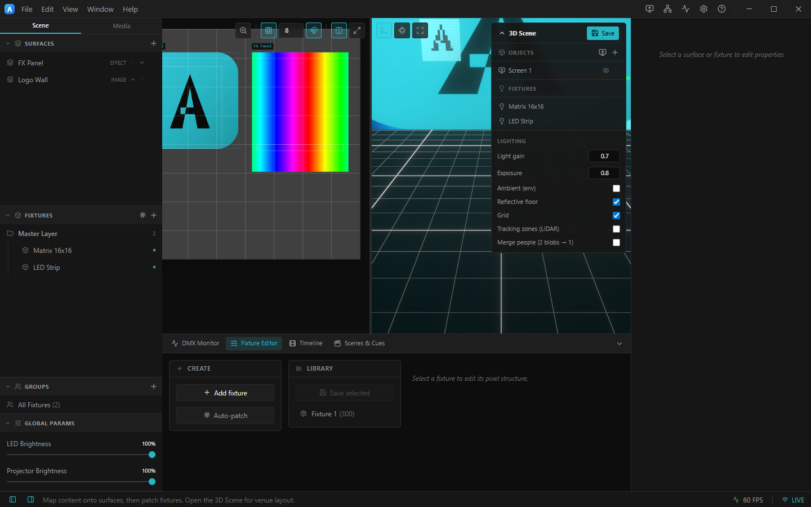
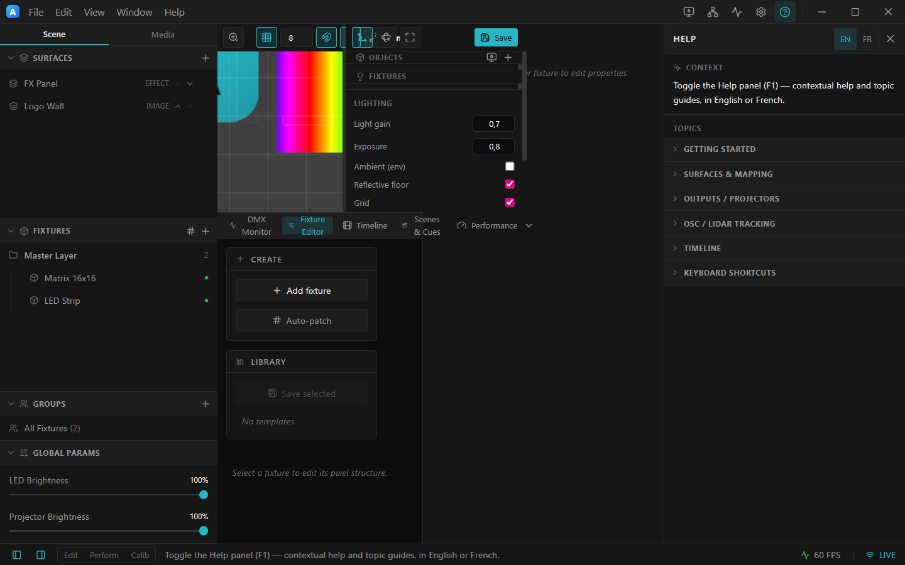
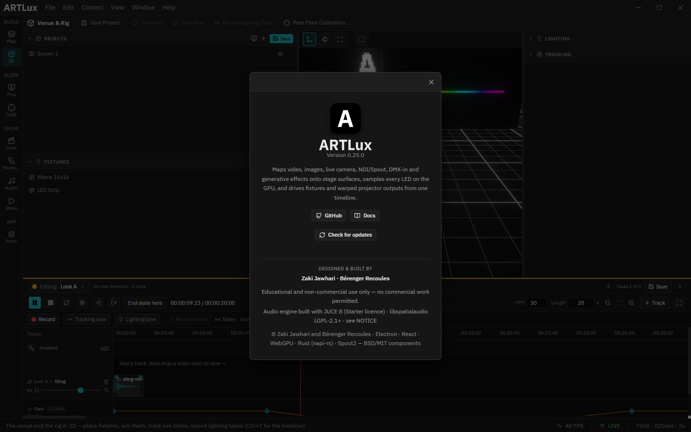

# 1. Interface tour

This page names every part of the editor so the rest of the guide can refer to them. If you only
read one page first, read this one.

*The whole editor at a glance: the workbench rail on the far left, the browser column, the viewport,
the dock beneath it, the parameters column on the right, and the timeline drawer along the bottom.*

---

## The one idea: workbenches, and nothing is nailed down

The editor is not one layout. It is **nine workbenches**, one active at a time, chosen from the
**rail down the far left**. Each declares the whole screen around its main view: which lists appear,
which parameters, which panels in the dock, and which actions sit on the action bar.

**And the arrangement each one ships with is a starting point, not a fixture.** Every panel can be
dragged into another group, split off into its own pane, closed, or added where it does not normally
appear — per workbench, remembered, surviving a restart. See [Making it yours](#making-it-yours).

So when this guide says "the browser column" or "the dock", it means *where a thing ships*, so you
can find it the first time. After that, it is wherever you put it.

| Cluster | Workbenches |
|---|---|
| **BUILD** | **Map** — surfaces, content, fixtures, patch · **3D** (Venue & Rig) — the venue scene, the lighting rig, tracking |
| **ALIGN** | **Proj** — projector outputs · **Calib** — projector calibration |
| **SHOW** | **Cues** — scenes & the cue grid · **Machine** — the show graph · **Audio** · **Show** — running it |
| **APP** | **Prefs** |

Switch with the rail, **Ctrl+1..9**, the **Context** menu, or **Ctrl+K** — the command palette, which
searches every workbench *and* every action any of them offers, and switches for you before running
one.

---

## Title bar (top)

A single dark strip carrying everything that frames the app:

- **The ArtLux mark** on the far left.
- **File / Edit / Context / View / Window / Help** menus — app‑styled dropdowns (the native menu is
  also registered, so every keyboard accelerator keeps working).
- **The workspace chip** — right of the menus, naming the saved layout you are in (it reads
  **Default** until you save one). Click it to switch, save, lock, or share a workspace; see
  *Saving a workspace* below.
- A draggable empty middle — drag it to move the window, double‑click to maximize.
- **Action icons** (right side): **3D Scene**, **Outputs**, **Routing**, **DMX Monitor**,
  **Preferences**, and **Help (F1)**. Hover any icon for a tooltip.
- The window **minimize / maximize / close** controls.

> Video/timeline **Play/Pause** does **not** live here — it's on **Space**.

The menus, in brief:

| Menu | Highlights |
|------|-----------|
| **File** | New / Open / Open Project Folder, Save / Save As, Collect Assets, Export/Import Rig, Routing, Preferences, **Launch in Broadcast Mode**, Quit |
| **Edit** | Undo / Redo, Cut / Copy / Paste, Select All |
| **Context** | **Workspace ▸** (save / switch / import / export a saved layout), then jump to any of the nine workbenches |
| **View** | Reload, Developer Tools, **Timeline** (the drawer), **OSC Monitor**, zoom, full screen |
| **Window** | Minimize, Close |
| **Help** | Help… (F1), Check for Updates, Documentation, GitHub, **About ArtLux** |

---

## Action bar

Under the title bar: the name of the active workbench and the actions that belong to it — *Add
Surface*, *Auto-patch*, *Routing* and *Collect Assets* in **Map**; *Store Key*, *Save Pose*, *Record
Lighting Take* and *Record Tracking Take* in **3D**. The two record buttons show **REC** and a running
clock while they are capturing, and stay clickable while they do — so the button that started a take is
always the button that stops it. Everything here is also in the **Ctrl+K** palette.

---

## Browser column (left)

The lists the active workbench works from — Surfaces, Fixtures, Groups and Global Params in **Map**;
Objects and Fixtures in **3D**; the media library in **Audio**. Add with **+**, double‑click to
rename, hover a row for delete/reorder actions.

---

## Viewport (centre)

Whatever the workbench is *for*: the 2D Stage, the 3D scene, the outputs table, the cue grid, the
show graph, Preferences. On the Stage, **surfaces are cyan** and **fixtures are red**; its top-right
toolbar has **zoom**, a **grid** toggle (with grid size), a **snap (magnet)** toggle, a **split‑view**
toggle, and **reset view**.

**Light fixtures — moving heads, washes, beams — are never drawn on the 2D Stage.** They are placed
and aimed in the **3D** workbench. See [3D scene](09-3d-scene.md).

---

## Parameters column (right)

Properties of whatever is selected, and **a surface and a fixture can both contribute sections at
once**. Sections are filtered by what *kind* of thing is selected, so an LED strip and a moving head
never see each other's controls: no colour order or serpentine toggle on a head, no pan/tilt on a
strip.

---

## Dock (under the viewport)

Tabbed panels: **Library** (DMX profiles + your fixture templates), **Wiring & Ledmap**, **Media
Library**, **Program** (the full-bleed program monitor), **Routing**, **DMX Monitor**,
**Performance**, plus **Output Preview** in Proj/Show and whatever the enabled plugins add (OSC
Monitor, Trigger Zones, Schedule, Playlist, Metrics…). Which ones a workbench *ships* with is its
choice; you can add any of them anywhere.

Drag the group's edge to resize; click the chevron to collapse.

---

## Timeline — a drawer, not a workbench

The timeline spans the **full width** of the window along the bottom, and it is available *inside*
eight of the nine workbenches (all but Calib and Prefs). Pull it up with **Ctrl+T**, **View ▸
Timeline**, or by clicking the collapsed strip; each workbench remembers whether you left it open.

That is deliberate: the timeline is a tool you want *while* working in a view — cutting against the
2D stage, dropping a recorded take onto a lane with the rig in front of you, authoring a scene's
timeline from the cue grid — not a place you travel to. See [Timeline](06-timeline.md).

Note that **recording** a take is *not* one of those things. Capture has nothing to do with the
playhead, so it lives in the **Lighting Takes** and **Tracking Takes** dock tabs (and on the action
bar, and on **Ctrl+Shift+R** / **Ctrl+Alt+R**) — which is why you can record from Calib and Prefs even
though neither has a timeline.

---

## Making it yours

- **Drag a panel by its tab** onto another group to join it, or onto an **edge** to split the space.
- **Right‑click a tab** for the same moves without a drag, plus **Close**.
- **+** on a tab strip adds any panel, including ones the workbench does not normally show, and
  carries **Reset this workbench** for when you want the shipped arrangement back.
- **Drag the dividers** to resize; **the chevron** collapses a group.

It is all per workbench, saved with your preferences, and survives a restart. If you would rather
have the fixed layout back, turn off **Preferences ▸ Appearance ▸ Dockable workspace**.

> None of this touches the show. The rendering engine does not live in the interface: output keeps
> running while you rearrange, and it keeps running even if a panel crashes.

### A panel in its own window

Some panels can leave the editor and open in a window of their own, which you can put on any screen:
**Surfaces**, **Fixtures**, **Groups**, **Global Params**, and the parameter sections for a fixture
(**DMX Profile**, **Channels**, **Patch**, **Mapping**, **Segments**, **2D / Output**, **Routing**,
**3D Layout**, **Position**) and a surface's **Content** and **Transform**, and the tracking panels:
**Trigger Zones**, **OSC Monitor**, **Augmenta Monitor** and **Pose Monitor**, and the shader panels:
**Shader** (the code editor), **Shader Nodes** and **Effects**, the monitors: **Timing**, **DMX
Monitor** and **Performance**, the patching docks: **Routing**, the fixture **Library** and **Wiring &
Ledmap**, and the 3D scene's side panels: **Objects**, its **Fixtures** list, a model's and a fixture's
placement (**Model**, **Arrange**), and the scene's **Lighting** and **Tracking** settings, the
**Show Machine** (the state graph), the **Lighting Takes** and **Tracking Takes** docks, and the **Media
Library**, and **Preferences**. A light's **Channels** faders on a second screen, next to the rig, is the
classic use; **Trigger Zones** on a screen beside the sensor, while
someone walks the room, is another; the **Shader** code on a screen of its own, with the stage beside
it, is a third.

- **Open one:** click **Open in new window** (the arrow-out-of-a-box button) in the panel's header, or
  right-click its tab and choose **Open in new window**.
- **It is the same panel, live.** It shows the open project and follows every change, whichever window
  you make it in: select a fixture in either and both show it selected, add one in either and both list it.
  **Undo** (Ctrl+Z), **Redo** (Ctrl+Shift+Z / Ctrl+Y), **Play / pause** (Space) and **Save** (Ctrl+S)
  work in a panel window too, and do exactly what they do in the editor, including your own rebindings.
  The editor's other shortcuts stay in the editor.
- **Sliders drag live.** Dragging **LED Brightness** or a light's channel fader in a window moves the rig
  as you drag, as it does in the editor; the value is kept when you let go, and **Record fader moves as
  keyframes** works from there too.
- **A parameter section follows the selection.** When what is selected is not its kind, the window says
  what to select instead of going blank.
- **Content in a window** picks a surface's source and sets it up, every source type, as in the
  editor. What it reports is the editor's: a **Camera** surface shows the camera the editor has open
  (the same device list, and whether it is live), a **Shader** shows the editor's compile errors and
  graphics card, and **Spout** / **Syphon** show why a sender cannot be received here.
- **Tracking panels in a window** show the room live, exactly as in the editor. **Trigger Zones** shows
  who is in which zone and the blobs and people the tracker reports, and a zone you draw, move or delete
  there is in the project at once. The **OSC Monitor** and **Augmenta Monitor** show the messages
  arriving on the OSC port. The **Pose Monitor** shows the pose tracker's status, speed and people
  count; the **camera picture** itself stays in the editor's Pose Monitor, because the camera is open
  there, and the window says so.
- **Monitors in a window** watch the editor: the **DMX Monitor** shows what the editor is sending, a
  light's channel table included; **Performance** shows the editor's frame rate and how busy its screen
  is, not the window's; **Timing** shows the show clock, the playhead and the current state as the
  editor runs them.
- **The 3D scene's panels in a window** edit the scene the editor shows: **Projected from view** on a
  model freezes the editor's 3D camera, and a model's named screens are the ones the editor loaded. The
  3D view itself stays in the editor.
- **The Show Machine in a window** is the editor's running show: the ring marks the state the show is
  in, double-clicking a state enters it, **Learn** catches the next press on the network, and **Edit
  timeline** opens that state's timeline in the editor, under the graph you left there.
- **Takes in a window** record in the editor: **Record** there starts the editor recording (the button
  and its clock follow it), and the take appears in the project's library with its activity graph.
- **The Media Library in a window** shows the same files, stills and take graphs. Its view (list, small
  or large icons) is the window's own; changing it there does not change the editor's.
- **Preferences in a window** changes the same settings as the editor's, every plugin's section
  included. A few settings belong to the editor window itself — **Dockable workspace**, the saved
  **Workspaces**, and the **3D view's** render scale, frame rate and live gizmo preview — and are shown
  greyed there, with a note to change them in the editor's Preferences.
- **Shader panels in a window** work exactly as docked. **Ctrl+Enter** compiles on the editor's
  graphics card, so the errors you see are the ones the show would hit, and only a shader that builds
  is saved. **Effects** saves and applies the same library the editor lists, with the same pictures.
- **A window is a small workbench of its own.** Its panel is a tab: **+** on the tab strip adds another
  panel to the same window, dragging a tab or **right-click ▸ Split** arranges them side by side, and
  closing the last tab closes the window. Asking for a panel that is already out (from the editor)
  brings its window to the front, on that tab, instead of opening a second one.
- **Back to the editor:** the arrow button above the panel, or **right-click its tab ▸ Back to the
  editor**, takes it out of the window and makes sure the editor's current workbench shows it.
- **Drag a tab from one window to another.** Drag a panel's tab out of a window and over the editor or
  another panel window: the same blue drop area shows where it will go (a tab, or one side of a split),
  and letting go moves the panel there. It works from the editor into a panel window too. A panel that
  cannot open in a window (a viewport, for instance) stays where it is, and a tab let go over nothing
  stays put. A window whose last tab you drag away closes.
- **It remembers where it was** on this machine, screen included, with its tabs and splits, and opens
  there next time. If that screen is not connected any more, the window comes back on the editor's
  screen, never off-screen.
- **It closes with the editor, and comes back with it.** A window you close yourself stays closed.
- The editor keeps its own copy of the panel; close the window, or send it back, when you are done.

**Viewports stay in the editor for now:** the stage, the 3D view and the output previews draw on the
graphics card inside the editor window. Their **Open in new window** entry is greyed out and says so.
Other panels will be able to detach as they are moved over.

If a panel window says it **cannot show the project right now**, the background service that holds the
open project for every window is not running (it can be switched off for troubleshooting). Use the panel
in the editor; the window recovers on its own when the service starts again.

> A crashed panel window does not touch the show, and does not leave a slider stuck: if it goes while
> you are dragging, the value goes back to what was set.

---

## Saving a workspace (and taking it to another machine)

Once the app is shaped for a job, name that shape. A **workspace** is a snapshot of *every* workbench
at once — panels, columns, tabs, and which workbench opens first — so you can keep one for patching,
one for programming and one for the show, and move between them in a click.

Everything lives on the **workspace chip** in the title bar (also under **Context ▸ Workspace**, and
searchable with **Ctrl+K**):

1. Arrange the app the way the job wants it.
2. Chip ▸ **Save Current Layout as Workspace…**, and give it a name.
3. Rearrange whenever you like — **there is no Save**. What you change is kept in the workspace you
   are in.
4. To move to another one, open the chip and pick it from the list. The show is untouched either way.

**Lock the show workspace.** Chip ▸ **Lock** stops changes being written into it. Panels still move
while you work; they are simply forgotten when you leave. It is the answer to a layout quietly
drifting on the night.

**Reset** puts every workbench in the workspace back to the arrangement ArtLux ships, keeping the
name — and it picks up any panel a plugin has added since.

### Sharing one between machines

Chip ▸ **Export All Workspaces…** writes a `.artws` file; **Import Workspaces…** reads one back on the
other machine. Manage the whole set — rename, duplicate, lock, export one, delete — in
**Preferences ▸ Appearance ▸ Workspaces**.

What travels is the *shape of the app*. What stays behind is anything describing the machine or the
room: **UI scale**, the **3D quality settings**, the **calibration file**, and your **keyboard
shortcuts**. That is deliberate — importing a colleague's workspace must never resize your interface
or rebind your keys.

Three differences between machines are handled for you, and ArtLux tells you when one applies:

| If the other machine has… | …then |
|---|---|
| A smaller screen | Columns and drawers are trimmed to fit — never scaled — so nothing ends up off-screen. |
| Fewer plugins (no NDI, Spout, calibration) | Their panels are skipped but keep their place, and reappear when the plugin is there. |
| A different ArtLux version | Any workbench arrangement it cannot read falls back to the shipped one, and you are told how many. |

---

## Status bar (bottom)

Panel toggles at each end, a one‑line contextual hint for the active workbench in the middle, and
live **FPS** + a **LIVE** output indicator on the right.

While a take is recording, a red **REC** light appears on the right, naming what is being captured and
**which document it will land in** (`REC lighting → Act 2`). It is a button: click it to stop. That
matters because a recording can be armed with a keyboard shortcut from a workbench with no visible
record control — a light you cannot switch off would be a trap.

---

## Help

*One search box over the topic guides, the per-control entries and the documentation itself.*

Open it with **F1**, a tooltip's **? Learn more** link, or **Help ▸ Help…**. One searchable modal
over **three** tiers of content: the coarse **topic guides** (with an **EN / FR** toggle that is
remembered between sessions), a **per-function entry** for every control that carries a tooltip, and
**the documentation itself** — this guide, the tutorials and the reference pages, split by heading so
a result is the paragraph that answers you rather than a 700-line page to go hunting in.

Type to search all three at once; **Esc** closes. So one query for *blade* returns both the **Blade
tool** control and the *Editing clips* section that explains it — and a term that appears only in prose,
like a calibration pattern or a spread mode, now finds its page instead of nothing. Documentation
results carry a 📖 book icon; pick one and **Open in Docs** takes you to that exact heading. Contextual
help for whatever you hover stays live in the status bar.

Documentation written for whoever *builds* ArtLux is still searchable, but it always ranks below the
operator pages — so a search answers with how to use the thing before it answers with how it is made.

### Searching the docs directly

The **Docs & Tutorials** browser (**Help ▸ Documentation**, or detach it to its own window) has the
same search at the top of its tree. Type and the tree is replaced by matching sections, each showing
its page and a snippet; click one to open that page scrolled to the heading. Clear the box to get the
tree back. This works with no internet, which is the point — it is the copy that ships with the app.

---

## About & updates

**Help ▸ About ArtLux** shows the version, links to GitHub and the docs, and a **Check for updates**
button (Windows/Linux auto‑update; macOS prompts you to download).

*About ArtLux — version, links, and update check.*

➡ Next: [Surfaces & content](02-surfaces-and-content.md)
