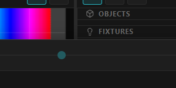

# 9. 3D scene

The **3D Scene** lays out fixtures in real‑world space and previews the show in 3D — handy for venue
design and client previews. It lives as a **split pane** beside the Stage (toggle it with the
split‑view button in the Stage's top‑right toolbar; drag the divider to resize).

*The 3D Scene (center‑right) with its outliner: OBJECTS (a "Screen 1" plane, models), FIXTURES, and a LIGHTING section. The LEDs light up with live output colors, so the view matches what your rig is doing.*

---

## Navigate the camera

| Input | Action |
|-------|--------|
| Left‑drag | Orbit |
| Middle / right‑drag | Pan |
| Wheel | Zoom |
| Click empty space | Deselect |

In **Box select** (**Q**) the left button draws the selection box and drags the selection, so the camera
moves the Rhino way there: **right‑drag orbits**, **middle‑drag pans**, the wheel zooms.

### Top, Front, Right — the flat views

The **view picker** in the 3D header switches between **Perspective** and six flat (orthographic) views:
**Top**, **Front**, **Right**, **Back**, **Left** and **Bottom**. A flat view has no perspective — a plan
from Top, an elevation from Front — so a row of fixtures that should be straight *looks* straight, and two
things at the same height line up on screen.

- **Keys** (with the pointer over the 3D view): **1** Front, **3** Right, **7** Top — the numpad or the top
  row; hold **Ctrl** for the opposite side (**Ctrl+7** Bottom). **5** or **0** goes back to Perspective,
  exactly where you left it.
- **A flat view pans and zooms; it does not rotate.** Left‑drag does nothing there — that keeps Top a true
  plan. To look around, go back to Perspective.
- The view you switch to keeps what you were looking at in the middle, at the same size on screen.
- **The corner axis widget** (bottom-right of the view) switches too: click an axis end and the view looks
  along it — red X → Right, green Y → Top, blue Z → Front, the small grey ends → the opposite side.
- **The grid follows the view's plane**: in Front and Back it stands on the wall plane (X across, height
  up), in Right and Left on the side plane — a ruler for heights and depths, not just the floor. Its numbers
  are still whole metres along the world axis they measure.
- While you **look through a calibrated projector** the picker is greyed: the projector owns the camera.
  Choose **Editor camera** first.

### Four views at once

The **four-view button** in the 3D header (or **Ctrl+Alt+Q** over the 3D view) splits the view into
**Top**, **Perspective**, **Front** and **Right** — the layout Rhino opens with — and back to one view. The
choice is kept on this machine.

- **Perspective** (top right) is where you orbit; **Home** / **F** frame every pane.
- **Top, Front and Right** show the same scene flat: **wheel** to zoom about the pointer, **right‑ or
  middle‑drag** to pan, **click** to select. Each has a ruler on its own plane.
- **Move, rotate and scale in any pane.** The gizmo of what you selected is drawn in all four; grab it
  wherever it is easiest. Front is the natural place to set a height, Top to place something on the floor.
  Grabbing a handle never moves a view, and releasing over another object does not select it.
- **The pane you last clicked is the active one** — its title is outlined.
- **Double‑click a pane's title** to make it the only view (Top as a plan, for instance); the four‑view
  button brings the four back.
- While four views are up the view picker is greyed — the panes *are* the views. Looking through a
  calibrated projector always shows one view.

### Saved views

Save where you are looking from and come back to it in one click — "FOH", "truss from stage left", "plan".

- **Save:** in the view picker choose **Save current view…**, or press **Save current view…** in the **Views**
  section of the 3D workbench's parameter column, and give it a name. A flat view keeps its zoom; a
  perspective keeps the camera's place and what it looks at.
- **Go back:** pick it under **Saved views** in the view picker, or click its name in the **Views** section.
- **Rename / delete** from the **Views** section (the pencil and the bin).

Saved views are part of the **project** — they travel with the show file to the venue PC, and **Undo**
takes a save, rename or delete back. They belong to the room, not to a scene: recalling a scene never
changes them.

### Venue display — Shaded, Wireframe, X-ray

The cube button next to the view picker (or **Z** over the 3D view) steps through how the **venue** is
drawn:

- **Shaded** — as it is.
- **Wireframe** — the models and screens as their edges.
- **X-ray** — the models and screens see-through, so a LED bar behind a wall or a fixture behind a screen
  stays visible while you place it.

Only the venue changes: fixtures, LEDs and beams always draw as they are. It changes this view only — not
the project, not the projector outputs.

### Rendered — see what the light will look like

The **sparkles** button beside the cube (or **Shift+Z**) turns on **Rendered**, a lighting simulation in
the spirit of Blender's rendered view. Use it to judge a look, not to judge content:

- Every moving head throws a **solid beam** in its colour **all the way to the floor**, and lands as a
  **pool of light**; its spotlight casts **shadows** from models and fixtures.
- LEDs and lenses **glow**, corners and the floor under things darken, and a **dark stage floor** catches
  the light even when there is no venue model.
- The room is lit by **the rig alone** — even when **Light gain** is at 0 — beams show even when **Haze**
  is turned right down, and the aiming diagram (the outline circles and rays) is hidden.
- Beams come from **moving heads and other light fixtures**; LED strips and bars glow but throw no beam.

**Colours are tone‑mapped** in Rendered, so they are not the exact values going to the wall: switch back
(the same button or **Shift+Z** returns to the mode you were in) to judge a picture. Rendered works in
**one view** and on the **WebGPU** renderer; in four views, or on the WebGL fallback, it draws as Shaded.
The eight brightest heads cast real pools and shadows — on a bigger rig every beam still draws, the
dimmer ones without a pool.

### Frame what you are working on

- **Zoom extents** (the frame button next to the view picker, or **Home**) fits every model and fixture in
  the view.
- **Zoom to selection** (**F**, or the numpad **.**) fits only what is selected — the selected fixtures, or
  the selected model. With nothing selected it frames everything.

Both keep the direction you are looking from; only the distance (or the zoom, in a flat view) changes.

### The 3D view on its own screen

**With the native engine** (ArtLux started with `--native-engine`), the **window** button in the 3D header
opens the 3D view in **a window of its own**, drawn by the engine rather than by the editor. It is an
ordinary window: drag it to any screen, resize it, maximise it — moving it costs the editor nothing.
**It comes back where you left it**: the next time it opens — later in the session, or after ArtLux is
restarted — it is on the same screen at the same size, maximised if it was. The place belongs to the
machine, not the project. If that screen is no longer connected, it opens at its default place instead.

- It opens looking from where the editor's 3D view looks. In it, **left‑drag** orbits, **right‑ or
  middle‑drag** pans and the **wheel** zooms; its camera is its own from then on.
- **Click a fixture there to select it** — in the editor, so its inspector and channel strip open there
  as if you had clicked it in the editor's own view. **Shift‑ or Ctrl‑click** adds a fixture to the
  selection or takes it out; a click on empty space clears it. A light is picked by its housing, an LED
  strip anywhere along its length. Selected fixtures show in the accent colour in both windows.
  **A venue model or screen is selected the same way** — click it, and the editor selects it (its card
  opens there); the engine window outlines it. A fixture mounted on a screen still wins over the screen
  behind it, as in the editor.
- **Move, turn and scale the selection there.** The handles of the tool chosen in the editor appear in
  the engine window too: with **Move**, drag the red, green or blue arrow to slide the selection along X, Y
  or Z; with **Rotate**, drag a ring to turn it about that axis; with **Scale**, drag a handle to stretch a
  single fixture, or to spread a group apart or pull it together along that axis. It follows the editor's
  **World / Object** axes and its **snap**, the editor's own view follows the drag, and each drag is one
  step to **Undo** — exactly as if you had dragged the handle in the editor. (Clicking a fixture that is
  part of a selected group keeps the group, as in the editor; click empty space first to start over.)
- It shows the **venue models**, the **screens with their live pictures**, **every LED in its live
  colour**, the **light fixtures** (as housings) and the floor grid **with its numbers** (whole metres
  along both axes, where you are looking — turned on and off with the editor's own grid and number
  settings), and follows every change you make in the editor within a quarter of a second.
- **Every lit head throws its beam**, the way the editor draws it: the haze cone in the head's live colour
  (the same **Haze** setting; the **Rendered** look's solid shafts to the floor when the editor's 3D view is
  in Rendered), and the **cone outline** where the beam meets the floor. The heads selected in the editor
  get the whole outline — the beam's axis and its edges — so you can aim on the editor's channel strip and
  watch the beam swing on the other screen. A head that is dark, or whose shutter is closed, throws nothing;
  only the 48 brightest cones are drawn as haze, as in the editor.
- **The projection preview comes with it.** Content on a venue model shows the way the editor shows it:
  a **screen named inside a Blender model** shows the picture you bound to it, a whole model shows its
  surface through its **Mesh UVs** or **projected** (from view or from a calibrated projector, with the
  same edge fade, back-face option and shadowing), and every **projector frustum** is drawn — the
  calibrated ones and the projectors placed in the model file.
- Close it with its own close button or the same header button.

It does not yet draw the rest of the Rendered look (the lit room); content the engine
does not draw yet (a video in a format no ArtLux decoder plays, a tracking surface with its calibration overlay…) stays dark there — those stay in the editor's 3D
view for now.

**Without the native engine**, the 3D view stays in the editor window: put the **editor window** on the
screen where you want the 3D view, open the **3D** workbench so the view fills it, and send the panels you
need on the other screen there with **Open in new window** — the outliner's sections, the fixture panels,
the Media Library and the timeline can all go.

---

## Read the scale

The floor grid is a ruler. Its **density follows the zoom, smoothly** — zoom out and the fine lines
fade away while the ten-times-coarser ones take over; zoom in and finer lines fade in between them, so
there is never a jump from one scale to the next. Lines a metre apart when you are looking at the whole
venue, ten centimetres apart when you are down on a single fixture. It
**follows what you are looking at**, so there is always a floor under the thing you are working on even
when that is a long way from the centre of the world. Whatever it re-scales to, its lines land on round
coordinates, and **Grid numbers** prints the **whole metres** — `1`, `2`, `3`, no unit, because the floor
is always read in metres — **on the floor**, along the X and Z lines they measure. A line between two
whole metres carries no number, and the figures thin out the same way the lines do: zoomed out, the
`1`, `2`, `3` fade and the `10`, `20`, `30` stay. They keep the same size on screen at any zoom. They lie in the floor's perspective like the lines do, turn round when you walk the camera
to the other side so they always read the right way, and are **hidden by anything standing in front of
them** — a screen or a model covers the figures behind it, just as it covers the grid.

The three coloured arms standing on the floor — red **X**, green **Y**, blue **Z** — mark the **world
origin**, the point `(0, 0, 0)` that every position you type into an inspector is measured from. They
keep the **same size on screen** at any zoom, so the origin is always easy to find; for real sizes, read
the grid lines and their numbers.

The grid is what to reach for when an imported model looks wrong. A `.glb` arrives at whatever unit the
program that exported it was using, and a model built in millimetres comes in a thousand times too
small — or a thousand times too big — with nothing to say so. Drop it in, look at it against the floor,
and if it does not match, select it and use **Fit** in the Model panel to give it a real size in metres.

Both are under **3D Scene ▸ Lighting**: **Grid** hides the floor and the origin arms together, and
**Grid numbers** hides just the figures — useful when you want the floor for reference but a clean
frame for a client screenshot. Neither is part of a scene's look, so firing a cue will not put them
back on screen.

---

## Transform a fixture in 3D

Select a fixture, then **W** move / **E** rotate / **R** scale / **Q** box‑select (or the gizmo buttons
in the viewport header), and drag the gizmo. The tool keys answer **only while the pointer is over the
3D viewport**, so they never take a key away from the timeline drawer below it, and they are rebindable
like every other shortcut — see [Keyboard reference](15-keyboard-reference.md).

The gizmo moves the **whole selection**, not just the fixture you clicked last: it sits on the
selection's centre, translate adds the same offset to every fixture, rotate swings them around that
centre *and* turns each one, and scale spreads them apart (a single fixture has nothing to spread from,
so scale resizes its own LED run instead).

### Snap and nudge — placing something exactly

The **magnet** (or **S**) makes a drag land on whole steps; the step next to it is the one it uses, and
it follows whichever tool is armed (millimetres to move, degrees to rotate, a factor to scale). Hold
**Ctrl** during a drag to invert it for that drag only — so snapping can be left on and still get out of
the way.

The same step drives the **arrow keys**, which is usually the faster way to be exact:

| Key | Move tool | Rotate tool |
|---|---|---|
| ← → | one step left / right | yaw the selection |
| ↑ ↓ | one step away / towards you | tip the selection |
| PageUp / PageDown | one step up / down | — |
| **Shift** | ×10 | ×10 |
| **Alt** | ÷10 | ÷10 |

Left and right follow **your view** — whichever world axis currently points leftish on screen — so they
keep meaning the same thing after you orbit, while still moving along an exact axis. With the magnet off
the arrows fall back to a fine 10 mm / 1°. One press is one undo step.

While you drag, the header shows what the gesture amounts to: the offset and total distance, the angle
turned, or the scale factor — so a placement can be checked *before* you let go.

### Drag onto a corner, an edge or a fixture end — object snaps

**Press on something that is already selected and drag it** — a fixture, a model or a screen, in any
tool and in any of the four views. The point you pressed is the point that lands:

- **Grab it where you want it to meet the target.** Press near one of its own ends, corners or its
  centre and it takes that exact point — so a LED bar taken **by its end** and dropped on the end of
  another bar chains onto it with **one pixel pitch across the joint**.
- **Drop it on a snap.** While you drag, a small marker sits on the point it will land on and names it:
  **End** (a corner of a model or screen), **Mid** (the middle of an edge), **Edge**, **Face** (anywhere
  on a surface), **Centre**, **Fixture end**, **Fixture centre**.
- **Nothing to snap to?** It slides on the floor‑level plane (in a flat view, on that view's plane) and
  lands on the grid step when the magnet is on.

The **crosshair** button beside the magnet (or **O**) turns object snaps on and off; the small arrow next
to it chooses which ones are on — End, Mid, Centre and Fixture to start with. Hold **Alt** to ignore them
for one drag, **Ctrl** to invert the grid, **Esc** to put it back. One drag is one undo step, and the
header shows the offset as you go, as it does for the gizmo.

**Place on a surface.** Turn on **Face** in the menu and drop a fixture or a screen on a wall, the floor
or any part of a model: it lands where you point **and turns to lie flat against it, facing out** — a LED
bar's LEDs face out of the wall, a screen lies flush with its picture outward. It turns by the smallest
amount that does that, so a bar keeps its run direction as near as the surface allows. **Turn to face the
surface** at the bottom of the same menu switches the turning off when you only want the position.
Venue models are only moved, never turned.

The gizmo stays as it was for moves along one axis, turning and scaling.

### Measure

The **ruler** button (or **M**) turns on the measure tool. Click a point, then another: a line joins them
with the **distance**, its **X / Y / Z** parts (Y is height) and the **angle from level**. Each click lands
on the same snaps as a drag — a corner, the middle of an edge, a fixture end or centre — and on any surface
under the cursor; with nothing there, on the floor. Before the second click the line follows the cursor, so
you can read a distance without committing it. A third click starts again, **Esc** clears, and **M** or the
button leaves the tool. Measuring never selects or moves anything, and dragging still orbits.

### Scale — each axis on its own

The scale gizmo's three handles are **independent**, and they always work in the fixture's own frame:

| Axis | What it stretches |
|---|---|
| **X** | along the LED line — the matrix's columns |
| **Y** | across the matrix's rows |
| **Z** | through the housing (depth) |

So a 16×16 panel can be made **wider than it is tall**, and an arc can be flattened, without touching
the LED count or the patch. On a plain **line** strip only X moves the pixels — there is nothing along
Y or Z to move — but Y and Z still thicken or thin the drawn housing. Typing exact numbers works too:
**Scale (×)** in the Inspector's 3D Layout card (or Position card, for a light).

Scaling **several** fixtures at once spreads them apart instead, per axis — pull a row apart along the
truss without also lifting it off.

### World or Object axes

The **globe / cube** button (or **X**) switches what the handles line up with:

- **World** — the room's X / Y / Z. What you want for hanging things level.
- **Object** — the selected fixture's own axes. A bar angled across a truss can then be slid along
  **its own length**, or turned about its own axis, instead of along a room axis you have to correct
  for afterwards.

With several fixtures selected the handles take the orientation of the **last one you clicked**. Only
the axes change: the gizmo still pivots on the **middle of the selection** in both modes, so switching
can never move where a rotation turns about or where a spread spreads from. The setting is remembered
per machine and never travels inside a project.

### While you drag

The fixtures **follow the handle as you drag**, and the project is written once when you **release** —
one move, one undo step. Two limits are deliberate, so the drag stays smooth on a big rig:

- On a very large selection the LEDs stop following and only the fixture **bodies** move with the
  handle. The pixels land in place on release.
- Beams and simulated fixture lighting do not follow a drag; they re‑aim when you let go.

If the drag feels heavy on this machine, turn off **Preferences ▸ GPU rendering ▸ Live gizmo preview**:
the rig then jumps to its new pose on release, exactly as it used to.

For exact values, use the Inspector's **3D Layout** card:

- **Position (m)** — X / Y / Z in metres.
- **Rotation** — pitch / yaw / roll (degrees).
- **Scale (×)** — per axis, in the fixture's own frame (see above).
- **Layout** — `line` (spacing), `matrix` (cols / rows / serpentine), or `arc` (radius / angle). This is
  the *physical* arrangement of the LEDs in space, independent of the 2D stage placement.

---

## Arrange a selection — building a rig, not moving one fixture

Select **two or more** fixtures and the Inspector grows an **Arrange** card. Nobody places twelve heads
on a truss by typing twelve coordinates; this is the set of gestures that replaces that.

- **Move by (m)** — shift the whole selection by an exact offset, keeping its shape. *Reverse* applies
  the same offset the other way, so an experiment is one click to undo by hand. This is the one thing a
  drag cannot do however finely it snaps: *250 mm that way, from wherever this is now*.
- **Turn about the centre** — swing the selection around its own middle by an exact angle. **Y** is the
  usual one (round, about the vertical); **X** / **Z** tip it. Each fixture turns *with* the group, so a
  row keeps its relative aim.
- **Align** — put every fixture on the same X, Y or Z.
- **Distribute evenly** — even out the spacing along one axis, leaving the two end fixtures put.
- **Lay on a line** / **Lay on an arc** — respace the selection at a spacing, or onto a curve of a given
  radius and sweep. *Arc + aim out* also turns each fixture to face along its own radius.
- **Fan the aim** — spread yaw, pitch or roll linearly across the selection: select a row, fan tilt, and
  the beams open into a wedge.

Everything except *Distribute* and *Align* works in **selection order** — the order you clicked them —
so a spread runs the way you built it. Each action is one undo step.

## Duplicate a screen

A venue is built out of repeated geometry — a row of panels, two matching side screens, the same
flown surface three times. Select a screen in the scene or the outliner and press **Ctrl+C**, then
**Ctrl+V**; **Ctrl+D** does both in one press. **Del** (or **Suppr**) removes the selected screen.

The copy is the same object, moved: it keeps its size, its rotation, what paints it (the timeline
layer or the surface), and its projection mapping. It lands a metre along X so you can see it is a
second object, and you place it from there. On a twenty-metre venue mesh a metre barely shows — that
is expected, the copy is selected and ready to be moved.

**The projection mapping comes across on purpose.** Projected UVs re-project live, so a duplicate at
its own position gets its own correct mapping from the same projector rather than staying glued to
where the original stood — two panels lit by one projector is the ordinary case in a mapped venue.

> Fixtures and surfaces copy the same way — see
> [Fixtures ▸ Copy and paste](03-fixtures.md#copy-and-paste).

## The outliner (top‑right of the pane)

Lists everything in the scene under **OBJECTS** and **FIXTURES**:

- **Add** screen **planes** (the **+** in OBJECTS) to show surface/timeline content on a flat panel in
  3D — useful as a backdrop or projection screen.
- **Load a venue model** (`.glb` / `.gltf`) via the Media library or the outliner, then position/scale
  it.
- Toggle each item's **visibility** (the eye), select it to edit, or remove it.
- The scene layout is saved with the project — **Save** (**Ctrl/Cmd+S**).

---

## Show content on an object

Select a plane or a mesh and pick a **Content** source in the Model card:

- a **Surface** — the object then shows whatever that surface is playing (a video, an image, a
  camera, NDI, Spout, an effect, a timeline layer, the whole timeline). This is the one to use for
  projection mapping. **Any** surface works, not only the one routed to this projector: the usual rig
  is one content surface covering the venue with two or three calibrated projectors all painting it
  from their own viewpoints. Binding to the projector's own surface is the cheapest option, because
  that window is already being sent that picture.
- a **Timeline layer** — a single track of the NLE, or **★ Timeline (Program)** (the **TL** shortcut
  button) for the whole composite, z-ordered across every contributing layer.

All of these reach a **calibrated projector output**, not just the editor's 3D view — and screens
authored as planes are venue geometry like any imported mesh. For a show that is one video on
geometry, binding the **layer** (or a surface playing it) is sharper than the Program, which composites
into its own frame and resizes once on the way through.

Planes display the frame directly; meshes get it textured through UV coordinates, and a **UVs**
selector chooses which:

- **Mesh UVs** — the UV map authored in the GLB file, read the standard glTF way: a mesh unwrapped
  upright in Blender shows its content upright. Two things can still go wrong and both are the
  file's doing, not yours: if it has no UV map (common for CAD exports) there is nothing to spread
  the picture across and the whole mesh shows a single flat color, and if the unwrap itself is
  upside down so is the content. Projecting sidesteps both, because the mapping then comes from a
  matrix rather than from the file.

  > **Projects made before October 2026:** ArtLux used to read a standard glTF unwrap upside down. A
  > mesh bound with **Mesh UVs** whose content was turned over to look right will now be upside down
  > — turn the content back (or the unwrap in Blender).

  > **Projected content, before 24 November 2026:** from October until then, both **projected** modes
  > painted the picture **upside down** on the mesh in the 3D view, and shadowed the wrong places when
  > something stood between the projector and the venue. Both are fixed — the top of the picture lands at
  > the top of the projector's frame, as it always did in a baked calibration file. If you turned
  > content over to make a projected mesh look right in the 3D view, turn it back.
- **Projected from view** — projects the mesh from a **frozen** 3D viewpoint: orbit the camera until
  the mesh is framed the way the content should land, then press **From view**. From that viewpoint
  the content reads as a fullscreen image. The viewpoint does not follow the camera afterwards; press
  **From view** again to re-capture.
- **Projected from a projector** — the live option, and the one that matches how disguise, VIOSO and
  Modulo Pi work. Pick one of your **calibrated projectors** and the content is thrown onto the
  geometry from exactly where that projector really is. It **follows** the projector: re-solve the
  calibration or move the mesh and the mapping updates itself, with nothing to re-bake. Only
  projectors with a solved pose are listed.

Both projected modes handle geometry the authored path cannot: faces behind the projector are left
dark rather than smeared with a mirrored copy, and a mesh with no UV map at all works normally.

Four extra controls appear while projecting:

- **Edge** — fades the content out at the edge of the projector's frustum (0 = a hard boundary). With
  two projectors covering one object this is what makes them cross-fade instead of meeting at a
  visible cookie edge.
- **Cull back faces** — drops faces turned away from the projector, so content does not wrap around
  and appear mirrored on the far side. It answers only *is this face turned away?*, never *is
  something else in the way?* — on a closed, convex object it is exact and costs nothing.
- **Occlude** — the general case, and **on by default**. A real projector cannot light what it cannot
  see, so a nearer surface shadows a farther one exactly as the light itself would: content stops at
  the silhouette of whatever is in front, instead of carrying on through onto the wall behind. This
  is what a concave venue needs — a pillar in front of a wall, a mesh with a recess, a screen hung in
  front of the set. Everything visible in the 3D scene casts a shadow, including screens and meshes
  with no content of their own, so hiding a mesh with the eye toggle also removes it from the
  shadows. Turn it off to light the whole frustum through, which is how projection behaved before
  this control existed.
- **Bias** — the margin, **in metres**, that the occlusion test allows before it calls a surface
  hidden. Only two things go wrong and each has one direction: too small and a surface **shadows
  itself** — stripes or speckle across flat geometry, worst where the projector rakes across it at a
  shallow angle; too large and content **creeps a little past a silhouette** onto what is behind it.
  The default 0.02 m suits venue-scale geometry. If you see stripes, raise it a couple of centimetres
  at a time and stop at the first value that is clean.

Switching back to **Mesh UVs** keeps the captured viewpoint, so comparing the two is a two-click A/B —
nothing in the GLB file is modified by any of this.

---

## Import a Blender file

Load a **`.blend`** directly with the **+** in OBJECTS (or the Media library), the same way as a
`.glb`. ArtLux asks the Blender installed on this machine to convert it — in the background, in a
couple of seconds — and loads the result.

- **It lands where Blender has it.** The model keeps Blender's own origin and sits at the world origin,
  so ArtLux coordinates are Blender's: a screen 2 m up in Blender is 2 m up here, and a projector
  placed in Blender stands exactly there. (A `.glb` is centred on itself instead, as before.)
- **Save in Blender, and ArtLux follows.** While the project is open, every `.blend` in the scene is
  watched. Press **Ctrl+S** in Blender and within a few seconds ArtLux re-imports it — a notice says
  *Updated from Blender* — keeping every screen's content and every placement. Adding geometry does
  not move anything already there.
- **The project carries both files**: the `.blend` you edit and the converted model it plays. A
  machine that only plays the show — the venue PC — **does not need Blender**; it uses the converted
  model. Blender is needed only to import or to update.
- **Which Blender:** the newest one installed in the standard place. To use another, set its path in
  **Preferences ▸ Blender**, which also shows the one in use. If none is found, or Blender cannot read
  the file, ArtLux says so and shows Blender's own message.

Everything below — named screens and projectors — works the same whether you load the `.blend` or a
`.glb` you exported yourself.

---

## Screens named in Blender

A venue usually holds several screens, and each one should play something different. Rather than
cutting the venue into one file per screen, name the screens in Blender and ArtLux finds them.

**In Blender:**

1. Give each screen object a name that **starts with `screen`** — `screen_main`, `screen_left`,
   `SCREEN-02`, `Screen.001`. Upper or lower case does not matter. It is the **object** name that
   counts (the one in the Outliner), not the mesh data's name.
2. Unwrap its **UVs** the way the picture should lie on it: the whole 0–1 square across the face, with
   the top of the image at the top of the screen. A 16:9 screen with a full 0–1 unwrap shows a 16:9
   picture without stretching.
3. Save, and load the `.blend` in ArtLux (above). Keep working in metres — ArtLux reads one unit as one
   metre. To hand over a `.glb` instead, export with Blender's **File, Export, glTF 2.0** menu, format
   **glTF Binary (.glb)**, with **+Y Up** on (the default).

A group works too: name an empty `screen_wall` and every mesh under it is one screen.

**In ArtLux:** load the `.blend` (or `.glb`) as a venue model. Each screen appears **indented under the model** in
the outliner, and the Model card gains a **Screens** list with a content picker per screen — the same
choices as the model's own: **★ Timeline (Program)**, any **Surface**, or one **Timeline layer**.
Clicking a screen in the 3D view or in the outliner points at its picker.

- A screen set to **— as the model —** shows whatever the whole model shows. So you can paint the
  room with one surface and still give the main screen its own layer.
- The picture is mapped through **your UVs** — the projected modes above apply to the rest of the
  model, not to a named screen.
- Screens **move with the model**. Blender is where they are placed; to move one, move it in Blender
  and export again.
- **Exporting again keeps every binding**, because bindings are matched by name. Rename a screen in
  Blender and its old name stays in the list in **amber**, still bound, until you clear it with its
  bin icon — so a rename never silently loses your content.
- Everything here reaches a **calibrated projector** exactly as the model's own content does.

Blender changes a few characters on export: spaces become `_`, and `.` `:` `/` `[` `]` are dropped,
so `Screen.001` is listed as **Screen001**. That is the name ArtLux matches on.

Try it with the ready-made room in `examples/blender-screens/`: one 16:9 screen named `screen_main` on
a wall, plus a floor, so you can bind the room and the screen separately.

---

## Projectors named in Blender

You usually know where the projectors will hang before you reach the venue. Put that in the Blender
file and calibration starts from there instead of from nothing.

**In Blender:** add a **camera** where the projector hangs, aimed where it throws, and give the camera
object a name that **starts with `projector`** — `projector_main`, `PROJECTOR-02`. Set its lens to
the projector's throw: with the sensor fitted **horizontally**, *focal length ÷ sensor width* is the
throw ratio (a throw ratio of 1.0 is a 36 mm lens on a 36 mm sensor). Load the `.blend` and the
camera comes with it. (Exporting a `.glb` yourself? It must include **cameras** — Blender's
*Include ▸ Cameras* option.)

**In ArtLux:** each projector shows in the 3D view as a cyan frustum that reaches the venue, moving with
the model — the green frustums are the *calibrated* projectors, which only move when you calibrate.
When you calibrate an output with the **Manual** flow, the Lens step offers it under **Projector
placed in the venue file**; **Start from it** takes its throw ratio and its position. The projection
then shows the venue's wireframe from where Blender put the projector before you place a single
point, and each point you click starts where that projector predicts — you drag it the last few
centimetres onto the real feature. See
[the Manual flow](../CALIBRATION.md#the-manual-flow-no-board-no-camera) for the steps.

The Blender position is only a **starting point**. The output is not calibrated, and does not render
the venue from it, until your points have solved. Lens shift is not carried by glTF, so a projector
with shift starts without it — enter it in the Lens step, or let the points find it.

**Moving a projector in Blender does not move its calibration.** Save, and within a few seconds the
cyan frustum turns or moves to match (the venue is reloaded, see
[Import a Blender file](#import-a-blender-file)); the output keeps playing its old calibration until you
calibrate again. To re‑aim an output that is already calibrated: **Calibrate ▸ Manual**, **Start from
it** on the moved projector, then **Clear points** — the old points describe the old aim, and while
they are there they keep solving it. Place new points, **Apply & finish**, then **Solve blend** again
if the output is part of a rig, and re‑export the calibration file if you use one.

The example room in `examples/blender-screens/` has one, `projector_main`, 6 m back and aimed at the
screen with a throw ratio of 1.0.

---

## Look through a calibrated projector

Once a projector output has been calibrated (see [Projector calibration](10-calibration.md)), a
**view selector** (camera icon) appears in the 3D toolbar. Pick a projector and the viewport renders
from *its* viewpoint, using the lens and position the calibration recovered — letterboxed to the
pane, never stretched, so what you see is honestly what that projector covers. It is the fastest way
to check framing and to see the content on the mesh as the projector will show it, with no projector
switched on.

While a projector view is active the camera is driven by the calibration, so orbiting is off (and
that projector's own frustum is hidden — you are inside it). Choose **Editor camera** to go back.
The selection is saved with the project, and it is *not* captured into scenes: recalling a scene
never moves your viewpoint.

---

## Lighting & preview options

The **LIGHTING** section controls the preview render: **Light gain**, **Haze**, **Beam cones**,
**Ambient (env)**, **Grid**, **Grid numbers**, plus **Tracking
zones (LiDAR)** and **Merge people** for visualizing live tracking in 3D.

The viewport applies **no tone mapping**: colours are shown as they were authored, with no filmic
roll-off on the highlights. That is deliberate — you are judging whether the preview matches the
wall, and a tone curve would misreport it. (There was an **Exposure** control here; it never had any
effect, because there was no tone curve for it to drive, and it has been removed rather than left
looking like it worked.)

### Making this viewport cheap

The 3D view is a preview, and a few of its options cost far more than the rest. If the viewport feels
heavy — or you simply want the frame budget spent on the show instead — these are the ones to reach
for, in order of how much they give back:

- **3D render scale** — **reach for this first on a weak GPU.** It lives in **Preferences ▸ GPU
  rendering**, not in this panel, because it describes what *this computer* can afford rather than what
  the scene shows: it is stored per-machine and never travels inside a project. It sets the resolution
  the viewport renders at, and the cost scales with the **square** — `0.5×` is a quarter of the pixels
  and roughly halves everything the viewport spends per frame. It applies live, so drag it while
  watching the scene and stop where it still looks right. On a high-DPI screen `1.0×` already looks
  sharp; go above it only on a workstation with headroom to spare.
- **3D frame rate** — the other half of the same idea, also in **Preferences ▸ GPU rendering**, and the
  one to reach for **when the render scale did not help**. Render scale cuts the cost of each *pixel*;
  this caps how many *frames* the viewport draws at all, so it cuts everything — every draw, every
  content upload — in proportion. Set it to `30 fps`, or `15` on a weak machine; orbiting and dragging
  stay usable well below 30, and the scene keeps animating at every setting.
  **It never slows the show down.** Mapping, LED sampling and Art-Net run in the frame engine, which
  keeps its own rate whatever this is set to; all that changes is how much of the GPU the preview is
  allowed to take from the output. How much that is worth depends on how expensive your viewport
  actually is — on a small pane already running on WebGPU it measured as no change at all, while on the
  WebGL path the same viewport was costing the editor about half its frame rate. Treat it as the second
  thing to try, after the render scale, and judge it by the **FPS** readout in the status bar.
- **3D Scene on WebGPU** — **on by default**, in **Preferences ▸ GPU rendering**. It renders this
  viewport with WebGPU instead of the older WebGL path, and the difference is not a tuning margin: on
  the laptop this was measured on, a scene holding nothing but two venue screens ran at **32 fps with
  the graphics processor completely saturated** on WebGL, against **60 fps** on WebGPU — and adding the
  ground grid and 24 more surfaces did not move it off 60. Turn it off only to compare; the viewport
  shows a warning badge whenever it is *not* on WebGPU, either because you turned it off or because this
  machine has no usable WebGPU adapter and it fell back on its own. Changes only the 3D preview — the
  pixel-mapping engine has always used WebGPU and is unaffected either way.
- **Light gain → 0** — this does more than dim the preview. Simulated fixture lights are **removed
  from the scene** at zero gain rather than merely turned down, which takes real per-pixel lighting
  work out of every surface in the venue. If your look comes from content on geometry rather than
  from simulated fixtures, this is close to free performance.

What remains at that point is close to a self-lit scene: LEDs, beams and any mesh carrying content
are drawn unlit already, and only the venue's own materials still need the ambient fill. Turning
**Ambient (env)** off as well dims those further, but is not worth much on its own — and taking the
base light away entirely would leave fixture bodies and the grid unreadable.

See [SCENES.md](../SCENES.md) for the full 3D model.

➡ Next: [Calibration](10-calibration.md)
