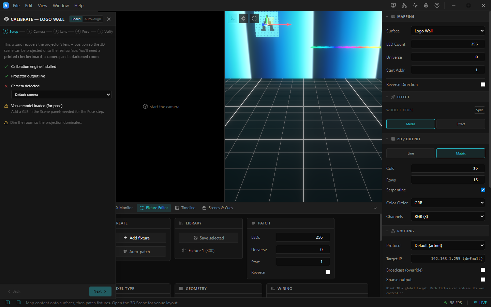

# 10. Projector calibration

Calibration recovers a projector's **lens + position** so the 3D scene can be projected onto the real
surface at 1:1.

> ### Calibration is a separate workbench — open it from **File ▸ Open Calibration Workbench…**
>
> The editor does **not** carry calibration by default, and the **Calib** entry is absent from the left
> rail until you open the workbench. That is deliberate, not a missing feature.
>
> A calibrated output does more than warp a picture: it renders the whole venue **a second time**, in
> its own 3D scene over the projector's canvas, so you can check the solve against the real wall. That
> is exactly right while you are aligning, and pure cost while you are authoring. Verified on the same
> project: with the workbench open a projector window carries three canvases; without it, one.
>
> Opening or leaving the workbench **saves and restarts the app** — the choice is made once when a
> window loads, and the editor's output windows have to agree with it. You will be prompted to save
> first if the project has never been written to a file.
>
> **Skip the restart: start there.** The [Launcher](17-installing.md#the-easy-path-the-launcher)'s
> Projects tab has an **Open projects in** control — set it to **Calibration** and the project opens
> with the workbench already loaded. On a machine whose job is alignment that is the better route: one
> launch instead of a launch and a restart, and the setting is remembered for next time.
>
> Everything that puts light on a wall keeps calibration regardless: **Broadcast** and headless launches
> always carry it, because a show's outputs *are* the calibrated ones. You never have to think about
> this at showtime.

Inside the workbench you launch a calibration from the [Outputs panel](08-projector-outputs.md): enable
an output, then click the **Calibrate** (target) icon on that row.

> **Hardware required:** the Board and Auto-Align modes need a **camera**, a **projector**, and
> (ideally) a darkened room. The wizard UI below is the real panel; with no camera connected the
> *Camera detected* check shows a ✗ and the camera steps wait for a device. **No camera at all?**
> Use the **Manual** mode — it needs only the projector and the venue's 3D model.

*The calibration wizard for "Logo Wall": Board / Auto‑Align modes, the 5 steps (Setup ▸ Camera ▸ Lens ▸ Pose ▸ Verify), and a readiness checklist.*

---

## Three modes

- **Board** — structured‑light + a **printed checkerboard**. Most accurate; recovers full lens
  intrinsics and pose. A ready‑to‑print board is in [`docs/checkerboard-9x6-25mm.svg`](../checkerboard-9x6-25mm.svg).
- **Auto‑Align** — markerless: you nominate a few correspondences and it solves the pose. Faster setup,
  no print needed. See [AUTO-ALIGN.md](../AUTO-ALIGN.md).
- **Manual** — no board, **no camera**. You enter the projector's lens specs, then pick matching
  points on the real object and the 3D model. Switch to it with the **Manual** button in the wizard
  header. See [Manual mode](#manual-mode-no-board-no-camera) below.

---

## The Setup checklist

The first step confirms you're ready:

| Check | Meaning |
|-------|---------|
| ✅ **Calibration engine installed** | The native OpenCV addon is present. |
| ✅ **Projector output live** | The output you're calibrating is On. |
| ❔ **Camera detected** | Pick your camera in the dropdown; ✗ until one is connected. |
| ⚠ **Venue model loaded (for pose)** | Add a `.glb` in the 3D Scene — needed for the Pose step. |
| ⚠ **Dim the room** | So the projection dominates the camera image. |

---

## The 5 steps

1. **Setup** — the checklist above; pick the camera and **Start the camera**.
2. **Camera** — frame the projector so the camera sees the whole projection.
3. **Lens** — capture the checkerboard / patterns to solve the projector's lens intrinsics.
4. **Pose** — solve where the projector sits relative to the venue model (PnP).
5. **Verify** — overlay the solved projection on the camera feed to confirm the fit.

**Back / Next** move between steps. The result feeds the projector output so the 3D scene maps onto the
real surface.

---

## Manual mode (no board, no camera)

Pick **Manual** in the wizard header. Instead of measuring the lens with a camera, you tell ArtLux the
lens and then anchor the projector by clicking matched point pairs. Four steps:

1. **Setup** — the checklist: calibration engine, output live, and a **venue model** in the 3D Scene.
   The model is the only metric reference in this mode, so it must match the real object's true
   dimensions.
2. **Lens** — with **Auto‑solve lens from the points** on (the default), you don't need to know the
   projector's optics at all: the throw ratio you enter is only a **starting guess**, and from 6
   points the focal is re‑estimated automatically on every solve. Enter what you know (throw ratio =
   throw distance ÷ image width; lens shift: 0% = centered, +100% vertical = image entirely above the
   lens axis), press **Apply lens**, and move on. Untick auto‑solve only if you trust the spec‑sheet
   numbers more than the points.
3. **Points** — pair points between the real world and the model:
   - On the **projector output**, click (or arrow‑key) the white crosshair onto a distinct physical
     feature of the real object — a corner, an edge junction.
   - In the **3D view**, click the same feature on the model — the click pairs with wherever the
     crosshair is, no confirmation needed. It snaps to the nearest mesh vertex (hold **Alt** to pick
     freely).
   - **Once the pose has solved, it gets easier:** just click a vertex on the model and the new point
     appears where the solve *predicts* that vertex sits on the projection — then drag it onto the
     real feature. Past the first four points you're nudging, not hunting.
   - Repeat with at least **4** pairs — more is better — spread across the image **and across depth**
     (not all on one flat face). The pose solves automatically from 4 pairs on.
   - **Why "across depth" is not just advice — and why the RMS won't tell you.** The Pose RMS says how
     well the pose *fits*; it does **not** say whether the lens is right. When every point sits at the
     same distance, a wrong throw ratio and a wrong distance are almost the same error — the solver
     quietly trades one for the other and still reprojects beautifully. Measured against a known
     answer: a throw ratio **10% wrong** put the projector **0.60 m** from where it actually was and
     reported **0.22 px**, which the wizard shows as a healthy green. So the panel also reports a
     **Depth spread** percentage beside the RMS. Amber or red there means *these points cannot see a
     wrong lens* — harmless if everything this projector covers lies at that one depth (a flat screen
     or cyclorama), and worth fixing otherwise: add points noticeably nearer or further and watch the
     RMS. If it climbs, the lens was wrong all along.
   - Every placed point is drawn **numbered on the projection itself**, in the right‑pane raster map,
     and on the 3D model — the same number everywhere, so you can stand at the object and see which
     features are already anchored.
   - **Project wireframe while picking** (on by default): from the first solve (4 points), the mesh's
     edges and **vertex dots** are projected live onto the object. You see exactly where the model
     thinks its vertices are versus where they really are, and every point you add or fix visibly
     pulls the wireframe into alignment. Aim the crosshair at a physical corner, click the matching
     (lit) vertex in 3D, watch it converge.
   - Once solved, each point shows its own error in pixels in the list — and on the projection a
     **red dashed leader line** runs from each point to where the solve thinks it belongs. A long
     line is a point that disagrees with the others; fix that one first.
   - Editing is direct: **drag the point** wherever you see it, and the solve (and the projected
     model) follows live —
     - drag its **marker in the 3D view** across the mesh (still snaps to vertices);
     - drag its **dot on the raster map** (right pane);
     - grab and drag the **numbered point on the projection itself**.
     The selected point's buttons offer the same as slower alternatives (**Move 3D point** — next
     model click re‑places it; **Re‑aim projector pixel** — the crosshair jumps there and the point
     follows it until **Done**/**Cancel**), and the trash icon deletes a point entirely.
   - With auto‑solve on, the panel shows which lens is in play (*auto‑solved from the points* vs
     *entered value*) and the current throw ratio. The auto‑solve is validated — when your points
     are too flat to support it, the entered lens silently stands, so add points at different depths.
     With auto‑solve off, a manual **Refine lens** button (≥8 points) and **Revert lens** do the same
     on demand.
4. **Verify** — enable **Test projection** and check the render lands on the real object. The **Look**
   buttons pick how the venue is drawn: **Edges** (the default — only the model's outline and panel
   creases, which is what you actually align against, and it reads even when the materials are dark),
   **Wireframe** (every triangle; useful only on very coarse models), or **Shaded** (the materials as
   the show will render them). The panel also shows the **solved projector distance** — compare it to
   the real throw distance: if it's off by some factor, your throw ratio is off by the same factor,
   so multiply the throw ratio by *real ÷ solved* in the Lens step and re‑apply (the pose re‑solves
   from your points automatically). Then **Apply & finish**.

**Apply & finish** saves the project and switches the output to **render‑from‑projector**: from then
on, in the normal show (not just the wizard), that projector renders the 3D venue from its own solved
viewpoint — content mapped onto the mesh lands on the real object, like any projection‑mapping setup.

Putting **content** on the mesh is done in the **3D Scene** context, not here — calibration only
solves where the projector is. In 3D Scene, select the model and pick a **Content** source: any
surface (so whatever that surface plays — video, camera, NDI, an effect, a timeline layer, the whole
timeline — is textured onto the mesh) or a single timeline layer.

**Any surface works, not just the one routed to this projector.** That matters on a rig: the usual
shape is one content surface covering the venue geometry, with two or three calibrated projectors all
rendering that same geometry from their own viewpoints. Bind every mesh to the one content surface and
each projector paints its share of it.

Binding a mesh to the surface routed to *this* projector is still the cheapest option (the window is
already being sent that picture), but it is no longer the only one that works. Each additional surface
a projector's visible geometry references is one more stream to that window — so if a heavily-bound
scene starts to feel uneven, that is the thing to reduce.

**Screens count as venue geometry too.** A flat screen authored as a projection plane is rendered on a
calibrated output exactly like an imported mesh, and takes the same Content bindings. (It used to be
skipped entirely, so a venue built mostly of screens showed nothing.)

**★ Timeline (Program)** also works on a calibrated output — the whole composite, every contributing
layer z‑ordered, on the geometry. It is sized to the largest source feeding it rather than to a fixed
720p, so on 1080p projectors it no longer arrives upscaled and soft. If your show is a single video on
geometry, binding the mesh to that **layer** (or to a surface playing it) is still sharper than going
through the composite, because it skips a resize.

**Moving a calibrated output to another display** is just the **Display** dropdown on that output's
row in Outputs — the calibration, warp, blend and *Render from projector* all belong to the output,
not to the display, so they come along. A change of **resolution** alone needs nothing (the solve is
resolution‑independent: a 1280×720 calibration renders identically at 1920×1080). A change of
**shape** does: if the new display's aspect ratio differs, the row shows **⚠ re‑calibrate**, because
the render would be stretched on the real object while the calibration still looked good. Re-run the
manual flow on the new display — your picked points are kept, so it re-solves in seconds.

The 3D Scene toolbar also has a **view selector** (camera icon) listing every calibrated projector:
pick one and the viewport renders from that projector's own recovered viewpoint, letterboxed to the
pane — so you can check coverage and see the content on the mesh exactly as the projector will,
without a projector switched on. The choice is saved with the scene; **Editor camera** returns to
free orbit.

> If the mesh shows one flat colour, its GLB has no UVs. Set **3D Scene ▸ UVs** to *Projected from
> view*, aim the 3D viewport the way you want the content to land, and press **From view**.
The **Render from projector** toggle on the output row turns it on/off later; the calibration itself
stays saved in the project.

Manual mode trades the board's accuracy for zero hardware: expect a good fit at the picked points and
small drift far from them. If you later get a camera, a Board calibration replaces the manual lens and
keeps your picked points.

### Multi‑projector

The same technique scales to a rig: calibrate **each output** with Manual mode **against the same
venue model** — the model is the shared reference, so every solved projector lands in one common
world frame automatically, each rendering the venue from its own viewpoint. Where projectors overlap,
use the **Rig blend** strip in the Outputs panel: with two or more calibrated outputs, press
**Solve blend** and each projector gets its share of the light so the overlap sums to one (no seam,
no double brightness). No camera scan is needed — the blend traces each projector's coverage from its
calibration and the venue model, so **open the 3D view once** in the session before you solve — it
is the view that loads the model the blend is traced against.
Recalibrating a projector marks the blend **stale** — re‑solve it when convenient, and **save** the
project afterwards: the blend is stored with each output.

The blend cross-fades along the direction the projectors are laid out: two side by side fade left to
right, each going dark exactly at the edge of its own picture. The edges of the screen itself are
not seams — nobody continues past them — so they do not shape the fade.

The fade is as fine as the overlap needs. **Solve blend** measures the narrowest overlap in the rig
and sizes the blend so at least 32 steps run across it, so a narrow overlap does not show bands. The
message after the solve gives the size it used, for example *432×243 map*. A very narrow overlap (a
few percent of the picture) hits a size cap, because the blend is saved in the project. If it still
shows steps, widen the overlap.

To check a blend without standing in front of the wall, press **Inspect** on the Rig blend strip. The
**Coverage Σα** view shows, for each projector, the total light every point it lights receives from the
whole rig: grey is correct, warm is too bright, cold is too dark. A few percent at the very edge of the
venue is sampling; a band or a gradient across the overlap is a real problem.

To start from a ready-made rig, open the
[multi-projector example](../../examples/multi-projector/README.md): two projectors placed in
Blender on one wide curved screen, with the steps to calibrate both and blend them.

### Finalising the mapping — nudging a calibrated output

A solve is rarely perfect on a real wall. Manual mode drifts away from the points you picked, a board
calibration can be a few pixels out at the edges, and venues move. So a calibrated output can still be
**warped by hand**, on top of its calibration.

Press **Align** on the output row exactly as you would for an uncalibrated one and drag the corners —
or tick **Bézier warp** first for the 16‑point mesh. The handles now bend the *calibrated render*: the
venue, drawn from the solved projector, moves with them.

Three things worth knowing:

- **Calibrate first, warp last.** The warp is a *residual* — it sits on top of whatever the solve
  produces. Re‑solving does not clear it, so after a better calibration press the **↺** button on the
  output row to clear the residual and see the raw solve before deciding whether it still needs one.
  That button never touches the calibration itself.
- **Once warped, the projection deliberately disagrees with the 3D model.** What is on the wall is no
  longer exactly what the calibrated scene says it is, so the 3D view remains true to the model rather
  than to the wall. This is the same trade every projection‑mapping tool makes; it is worth using the
  smallest nudge that fixes what you can see.
- **It costs something.** An output only pays while it actually carries a warp — leave one at its
  default and it is exactly as cheap as before. If several 4K projectors feel heavy, the **FPS cap**
  in the Outputs panel is the first thing to reach for.

On an NVIDIA rig with **hardware warp** enabled the handles do nothing in the window, because the
graphics card is applying warp and blend at the scanout instead — that is the correct behaviour, not
a bug, and it is what stops the correction being applied twice.

**NDI:** an output sending NDI while rendering from a calibrated projector used to publish black.
It now carries the picture.

### Checking it on the wall — the UV checker

To judge a calibration, play something that says where every point belongs. Give the screen's surface
the **UV checker** shader (Surface ▸ Content ▸ Shader ▸ **UV checker**, then **Full HD** or **4K**): a
labelled grid whose cells name their column, row and U/V, with coloured corners and an arrow pointing
up. It names the surface and outlines each Blender screen that shows it, so a misplaced point or a
swapped screen reads straight off the wall — "C4 landed where F2 should be". Look at the seams between
projectors: the grid lines must run straight across them. See
[Shaders ▸ The UV checker](../SHADERS.md#the-uv-checker--a-test-source-that-knows-the-project).

## Calibration files — make one when you need one

An output can put its picture on the wall in three ways, and a show can use any of them:

| The output is… | What it draws | Needs on the show machine |
|---|---|---|
| **a plain screen** — a monitor, an LED wall, a projector you align by hand | its surface, through its own corner-pin or Bézier warp | nothing |
| **live‑calibrated** | the venue, rendered from the projector's solved position | the venue's 3D model (and the calibration in the project) |
| **playing a calibration file** | its surface, through a map the file carries | the file — no 3D model, no Blender, no calibration workbench |

**Live calibration** is what you align with: it updates the moment you move a point, and it is what a
calibration wizard shows. It is also heavier — every projector window renders the venue again, and the
content on each screen is copied to every window. With a very large video that shows: a 5760×2880 clip
on two live‑calibrated projectors ran the editor at **4 fps**. The same clip through a calibration file
ran at **60 fps**, editor and projectors alike.

**A calibration file** freezes a finished calibration into a map. You do not need one for every show;
make one when the show machine is not the one you calibrated on, or when the content is heavy.

1. **Produce it.** In any calibration wizard, go to the **Verify** step and press **Export calibration
   (.mpcdi)**. One file holds **every** calibrated projector of the rig — warp **and** blend — because a
   blend only means anything for the set of projectors it was solved with.
2. **Give each projector surface the show's content.** A file plays each output's **own** surface
   through its map, not the screen surfaces of the 3D model. Bind the projector surfaces to the same
   layer or clip the screens show.
3. **Load it.** **Projection Outputs ▸ Calibration File ▸ Import calibration (.mpcdi)**. The panel lists
   each projector and how much of its picture lands on the venue — a region at 0 % means a wrong pose or
   a venue that moved after the export.

A loaded file **takes over** from the live calibration on every output it covers, in the editor and in
**Broadcast**, and the machine **remembers it**: it is loaded again at every start until you press
**Unload**. So on a machine where you loaded a file for one show, unload it afterwards.

To **recalibrate** on a machine that has a file loaded, press **Unload** first — a loaded file also
takes over from the wizard's live render. After Unload, an output with a calibration goes back to
rendering from it when the venue model is loaded; without the venue model it goes back to its own
corner‑pin warp, so it never goes black. Re‑export the file when you are done.

**ArtLux Calibrator reminds you.** When you hand a project back to ArtLux Show, the Calibrator compares
the file the show plays with your latest calibration or blend. If the file is older, it asks before
handing over:
- **Export and replace** writes the new calibration over the same file, so the show loads it with
  nothing else to do.
- **Hand over without exporting** keeps the old file. The show then plays the old aim.
- **Cancel** stays in the Calibrator.

The question only comes up when a file is loaded on this machine. A show that plays live calibration
has nothing to fall behind.

The format is **MPCDI**, a standard interchange format for warp and blend, and ArtLux can also
camera‑measure projector **gamma**. Full details, the optimization passes (ArUco one‑click recal,
masking, exposure, colour/black match), and troubleshooting are in [CALIBRATION.md](../CALIBRATION.md)
and [CALIB-OPTIMIZATIONS.md](../CALIB-OPTIMIZATIONS.md).

➡ Next: [Projects, media & broadcast](11-projects-media-broadcast.md)
