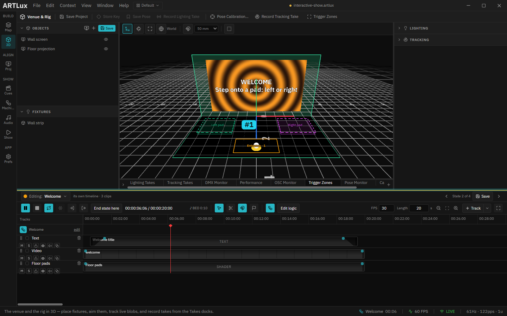
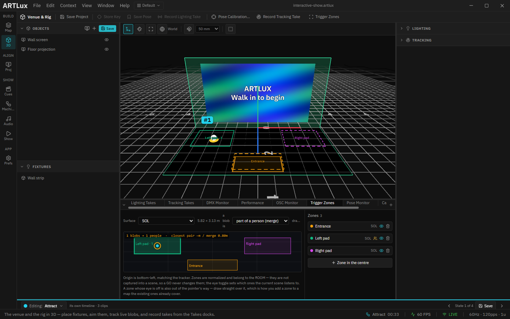

# 13. Tracking (LiDAR · camera · Augmenta)

**Tracking** brings the room into the show: live positions of people on the floor become data ArtLux
can visualize in 3D, project 1:1 onto the floor/wall, and — via **trigger zones** — use to drive the
[state machine](14-show-state-machine.md). A tracked person is a normalized `(u,v)` position (a
"blob"); every source maps onto a surface the same way, so the rest of the app doesn't care which
sensor produced it.

ArtLux ships three tracking sources, all interchangeable:

| Source | Sensor | How it arrives | Setup weight |
|---|---|---|---|
| **LiDAR** | a venue LiDAR/tracker server | custom OSC blob feed on **udp/10000** | the installation default |
| **MediaPipe** | any webcam | Google BlazePose, in‑app (no sensor) | lightest — a camera + one asset download |
| **Augmenta** | an [Augmenta](https://augmenta.tech) box | Augmenta **OSC v2** into the app's OSC listener | a pre‑calibrated optical box |


<!-- shot spec: examples/interactive-show, 3D context, visitor.cjs walk at ~8 s (Welcome, visitor in the Entrance), timeline drawer open on the Welcome timeline. -->
*Live tracking in the 3D Scene: the floor (SOL) and wall (MUR) at real scale, three trigger zones (solid while occupied, with a headcount), one marker per person, and a screen on the wall showing the look the visitor just triggered. From the [interactive-show example](../../examples/interactive-show/README.md), whose [course](../../examples/interactive-show/tuto/README.md) builds a whole room-driven show.*

---

## Enable the LiDAR feed (the installation default)

The venue tracker **sends** OSC to your machine; ArtLux **binds** to its own network card and receives.

1. **Preferences ▸ OSC / Tracking**:
   - **OSC receive** — on.
   - **Listen port** — **`10000`** (the installation default).
   - **Bind address** — **this** machine's IP (e.g. `192.168.61.32`) or **All**. *Never* bind the
     tracker server's IP.
   - **Control prefix** — `/artlux` (control messages only; the `/SOL` and `/MUR` tracking addresses
     are routed separately and never collide with it).
2. Confirm the bind in the log: `[osc] listening on 192.168.61.32:10000`.
3. **View ▸ OSC Monitor** (**Ctrl/Cmd+Shift+M**) — the fastest "is the tracker actually sending?"
   check. Expect a **green** dot, live **msg/s**, and **SOL** / **MUR** blob cards showing
   `active / total` slots. An **amber** dot at `0 msg/s` means the listener is up but nothing is
   arriving (server or network).

> **Ping the server first.** Being on the same subnet is not enough — `ping 192.168.61.21` (the
> tracker) before you expect blobs. 100% loss = the server is down or unreachable.

No tracker on the bench? Drive the whole pipeline with synthetic blobs. The emitter **ships with the
app** — it needs [Node.js](https://nodejs.org) on the machine, and nothing else:

```bash
# from a source checkout
node scripts/lidar-emitter.cjs 127.0.0.1 10000 3

# from an installed build — the script is under the app's resources folder
#   Windows  C:\Program Files\ArtLux\resources\scripts\lidar-emitter.cjs
#   macOS    /Applications/ArtLux.app/Contents/Resources/scripts/lidar-emitter.cjs
node "<that path>" 127.0.0.1 10000 3
```

---

## Enable camera tracking (MediaPipe)

A webcam + BlazePose, running in‑app — no specialized sensor. Inference runs in the main editor
window; projector windows receive the results.

1. **Nothing to install.** The WASM runtime and the pose models are staged into every released build, so
   an installed ArtLux already has them and this step is not yours.
   *Running from a source checkout?* Then they are not there until you fetch them once with
   `npm run assets:mediapipe`; without it the feature logs `[mediapipe] engine start failed` and no-ops
   silently.
2. Select a surface → content type **MediaPipe**. Tune marker size / skeleton / IDs / trails / flip /
   rotate in the Inspector.
3. **Preferences ▸ Pose Tracking (MediaPipe)** — pick the **camera**, model (lite/full/heavy), and
   delegate.
4. **View ▸ Pose Monitor…** — live camera preview, fps, and the tracked‑people count.
5. Toggle **Camera pose markers (MediaPipe)** in the 3D scene panel for the simulator overlay.

**Calibrate the camera: View ▸ Pose Calibration…** One window, three tabs, all over the live camera
picture. While it is open the people BlazePose sees are drawn on the picture, with their hands lettered
**L** and **R**, so you place corners where a hand really shows up.

### Mark the interaction area (camera trigger zones)

The **interaction area** is the part of the picture people interact with: a wall they touch, a screen,
the floor, or a box of air in front of the camera. [Trigger zones](#draw-trigger-zones-tracking-workbench--trigger-zones)
on the camera are drawn inside it, so marking it is the first step to a camera‑driven show.

1. Open **View ▸ Pose Calibration…** and stay on **Interaction area**.
2. Place the four corners **TL, TR, BR, BL** on the area. Either:
   - **Walk the corners** — stand at each corner in turn and hold a hand still for 2 seconds; the
     corner snaps to it and the next one is asked for. One person can calibrate a wall from the wall.
   - **Drag** the corners. A magnifier follows the corner you hold; click a corner and nudge it with
     the **arrow keys** (one camera pixel; **Shift** for finer). **Snap to hand** moves the selected
     corner to the nearest visible hand. Keys **1–4** select a corner.
3. Check the **grid** drawn inside the area: it should look like a flat grid lying on your wall or
   floor. A bent grid means a corner is off. Zones you have already drawn appear on the picture too.
4. Tick **Mirror (selfie view)** if the people face the camera and you want the area to read like a
   mirror. Left and right hands stay the person's own.
5. Set **Shape W÷H** to the area's real proportions (blank uses the picture's estimate), so a square
   zone is a square on the wall.
6. **Save area.** A shape the camera cannot use — corners crossed, in the wrong order, in a line, or
   too small — is refused with the reason, and the outline turns red.

Then open the **Test** tab and walk through your zones: it shows the saved area flat, every body part
it sees, and lights each zone as soon as a part it counts is inside.

**Safety nets.** Nothing is written until you save. Closing with unsaved changes, and **Clear…**, both
ask first; **Revert** goes back to the last saved corners and **Reset corners** to the starting
rectangle. The area belongs to the room, like the zones, so recalling a scene never changes it. If you
swap the webcam, the window and the zone editor warn that the area was marked on another camera. If the
camera fails to start, **Retry camera** tries again without restarting ArtLux.

### Floor (3D preview)

When the camera points *down* at the floor, the **Floor (3D)** tab places each person in the 3D scene at
real size. Drag the corners onto a floor rectangle whose real size you know, enter its **width** and
**depth** in metres, and **Save floor**. The top edge is the *far* side. The mapping assumes feet on the
floor, so a standing or walking person maps accurately and a jumping one briefly doesn't. This tab only
affects the 3D preview; camera zones use the interaction area.

---

## Draw trigger zones (Tracking workbench ▸ Trigger Zones)

A **trigger zone** is a named rectangle of a tracking surface that the show machine can react to —
*someone enters the entrance zone → play the reaction state.* Zones are the bridge between the blob
feed and the [state machine](14-show-state-machine.md).

**The mental model, in one breath:** zones are **the room** — project‑scope geometry shared by every
scene and state. You draw the entrance / stage / doorway **once**; changing the show's look never
recreates or loses them.


<!-- shot spec: examples/interactive-show, 3D context, Trigger Zones dock tab, timeline drawer hidden, one still person at u 0.19 v 0.65 (on the Left pad). -->

*The Trigger Zones panel: draw zones on the tracking map, set People needed per zone, and toggle the per‑scene eye. Live blobs are drawn **raw** so the two‑blobs‑per‑person is visible, with a ring around each person actually counted and the tally — `4 blobs → 2 people` — above them.*

**Author them** in the **3D** (Venue & Rig) workbench, on the **Trigger Zones** dock tab. Three ways
to it, all landing on the same tab — use whichever you are nearest:

- the **Trigger Zones** button on the Venue & Rig action bar (top of the window, beside *Pose
  Calibration…*);
- **Draw trigger zones…** at the top of the **Tracking** section in the right‑hand parameter column —
  where the dwell and merge settings below it already live;
- **View ▸ Trigger Zones**, from anywhere in the app — it switches to the venue workbench for you.

(There used to be a separate *Tracking* workbench; it merged into 3D — being *in* the 3D scene, where
the live blobs are drawn, is the better version of what it offered.)

- **drag on empty space** to draw a zone; **click** to select, **drag the body** to move, **drag a
  corner** to resize.
- Each zone carries **People needed** (default 1, counted *after* people‑merge).
- The **eye** toggle sets whether the **current scene** listens to this zone (dim + hollow = ignored
  in this scene). Leave every eye on and every zone is simply live everywhere.

**Tune the dwell once, on‑site.** How hard the tracker flickers is a property of the **room**, not of
any one zone, so the enter/exit dwell is a **venue‑wide** control in the tracking parameters (beside
*Smoothing* / *Merge radius*):

- **Zone enter dwell** (default **0.2 s**) — how long presence must last before a zone latches
  *occupied*. Raise it if arrivals fire too eagerly.
- **Zone exit dwell** (default **0.5 s**) — how long absence must last before it clears; also the
  **gap tolerance** for a person who briefly drops out. Raise it if a standing visitor keeps
  dropping.

A single zone can **Override dwell for this zone** for the odd entrance that must react faster (or a
lounge that must hold longer) than the rest of the room. The same zones appear in the 3D scene,
labelled with name and live headcount, so you can check they sit where you think.

### Zones on the camera area

Pick **Camera area (MediaPipe)** in the zone editor's **Surface** list. The map takes the area's real
proportions and shows every body part the camera sees, lettered: **L / R** hands, **l / r** feet,
**H** head, **B** body. Draw zones exactly as on a LiDAR surface. If the area is not marked yet, the map
says so and offers **Calibrate Camera area…**.

Each camera zone has a **Detect** row: **Any part**, **Hands**, **Feet**, or any mix of left hand, right
hand, left foot, right foot, head and body. Only the parts you pick count. **People needed** still
counts **people**: a visitor with both hands on a pad is one person, not two.

While a camera zone is live, ArtLux keeps the camera running, even if no surface shows the camera's
content. The camera sees in 2D: a hand "in" a zone means a hand in front of it from the camera's point
of view. Hands are BlazePose's wrist and index finger; there are no gestures (open hand, fist).

---

## Wire a zone to the show

In the [state machine](14-show-state-machine.md), a transition's **trigger** can be **Trigger zone**.
Pick it in the transition inspector and choose a mode:

- **One zone** — `someone enters` · `everyone leaves` · `occupied for…` · `empty for…` (the
  attract‑return rule) · `at least N people`.
- **Combination** — **ALL / ANY** of several zones, **each with its own rule** from that same list,
  optionally **NOT** — so *"somebody has been in the entrance for 5 s **and** the stage is empty"* is
  one edge instead of a chain of states. Each term shows a live dot while it is true. In a combination
  a rule reads as a state (`is occupied`, `has N+ people`) rather than an event, because a term is
  never an event of its own — the firing applies to the whole sentence.

> Two things that surprise people. **NOT is not the opposite rule:** `NOT (occupied for 5s)` is true
> when the zone is empty *or* somebody has been there under 5 s — that is not `empty for 5s`. And a
> combination is **simultaneous and order‑agnostic**: it fires whenever the whole sentence is true, so
> "stand here 5 s *then* walk over there" does not work as one rule if the visitor **leaves** the first
> zone. For a real sequence, put a state between the two steps.

Every rule is a **level** with an **arm‑and‑hold** behaviour: it can't fire until the world actually
changes (so a visitor still standing where they triggered the last hop doesn't re‑fire), and it stays
armed for as long as the condition lasts. Pair a zone trigger with **hold at end** + **only after the
state has finished** and you get the canonical installation state: *play the look to its end, freeze
there, advance when someone walks in* — instead of a visitor cutting the film three seconds in. See
[Show / state machine ▸ Hold a state at its end](14-show-state-machine.md#hold-a-state-at-its-end-interactive-installations).

---

## Record & replay takes (author with no tracker)

A **take** records the live blob feed so you can author, rehearse and run an interactive show with no
tracker present — replay is indistinguishable from the live feed.

1. **Record** — the **Tracking Takes** dock tab ▸ **● Record**. It captures the feed independently of
   Play/Pause, so the playhead can (and usually should) be stopped. Press **■** to stop, or **✕ Cancel**
   to throw the capture away; on stop the take appears in the panel and a green **Tracking** lane is
   created if there is none.

   The panel is in **Venue & Rig** and on the **Show** deck. Two other doors reach the same recorder:
   *Record Tracking Take* on the Venue & Rig action bar, and **`Ctrl+Alt+R`**, which works in *every*
   workspace — including Calibration, which matters on site, where you are often nowhere near a
   timeline. While it runs, the **status bar** shows a REC light naming the take's destination; click it
   to stop. If recording refuses (a take is already playing under the playhead, which would record
   replayed data), it tells you so.
2. **Place** — drag the take out of the panel onto the tracking lane (or drag it from the **Media**
   library). It shows the same blob‑density sparkline the take row does; move/trim it like any clip.
   Click a take's name in the panel to rename it.

   > **Takes recorded somewhere else.** Copy `.lblob` files into the project's `assets/tracking/`
   > folder and the **Tracking Takes** panel notices them on the next open: *"3 takes in this project's
   > assets/tracking/ are not in the library"*, with a button to add them. They are **not** adopted
   > automatically — deleting a take leaves its file behind so the delete stays recoverable, which
   > means a stray file could equally be one you discarded. Adding them is a document edit, so
   > **Save** afterwards or they will be waiting again next time.
3. **Replay** — with the tracker disconnected, **Play** or scrub: the recorded blobs drive the 3D
   scene, the trigger zones, and any *Tracking* projector outputs. Past the clip the blobs clear.
4. **Mixing with a live tracker** — while a take plays, the live feed is globally suppressed and
   resumes automatically once no take is under the playhead. Entering/leaving a take re‑arms every
   zone, so no phantom enter/exit fires across the boundary.

Takes are portable assets — they save into the project's `assets/tracking/` folder. For the lane a take
is placed on, see [the timeline ▸ Takes on a lane](06-timeline.md#takes-on-a-lane-replay-lidar-and-lighting-without-the-source).

---

## Tips & troubleshooting

- **Nothing arrives / OSC amber at 0 msg/s** — the listener is up but no packets: check the tracker
  server is running, the **Listen port** is `10000`, the **Bind address** is a local NIC (not the
  server's), and no firewall blocks inbound UDP.
- **`EADDRNOTAVAIL` in the log** — the bind address isn't on a local card. Use this machine's IP or
  **All**.
- **One person shows two markers** — turn on **Merge people**; raise the **Merge radius** toward 1.0.
  Distinct people merging → lower it.
- **Projected blobs mirrored / rotated** — toggle **Flip H / Flip V / Rotate** on the Tracking content
  until a person at a known spot lines up (the **Calibrate** overlay's U/V arrows show the data
  orientation).
- **A zone rule never fires** — confirm the current scene isn't **listening‑off** to that zone (the
  eye), that the transition leaves the current state (or is a **⚡ global rule**), and that the dwell
  isn't so high the flickery feed never latches.
- **A zone needs twice the people you asked for** — the count is in *blobs*, not people. Open
  **Trigger Zones** and read the tally on the map: `4 blobs → 2 people` is right, `4 blobs · merge
  off` means turn **Merge people** on, and a **red** `closest pair 1.20m / merge 0.80m` means the
  radius is too small for this venue — raise it past the gap.
- **The wall counts two people as one** — the wall's blobs are *hands*, not halves of a person. Set
  *a blob is* → **one whole thing — a hand** for that surface (Trigger Zones, beside the surface
  picker). Merging is per surface precisely so the floor and the wall can disagree.
- **MediaPipe does nothing** — on a source checkout you likely skipped `npm run assets:mediapipe`
  (a released build ships the assets, so this cannot be the cause there); check the log for
  `engine start failed`.

For the field procedure to sync with a real venue tracker (including the "1 person = 2 blobs" check),
see [`docs/TRACKING_SYNC.md`](../TRACKING_SYNC.md); protocol details in [`docs/OSC.md`](../OSC.md).

➡ Next: [Show / state machine](14-show-state-machine.md)
