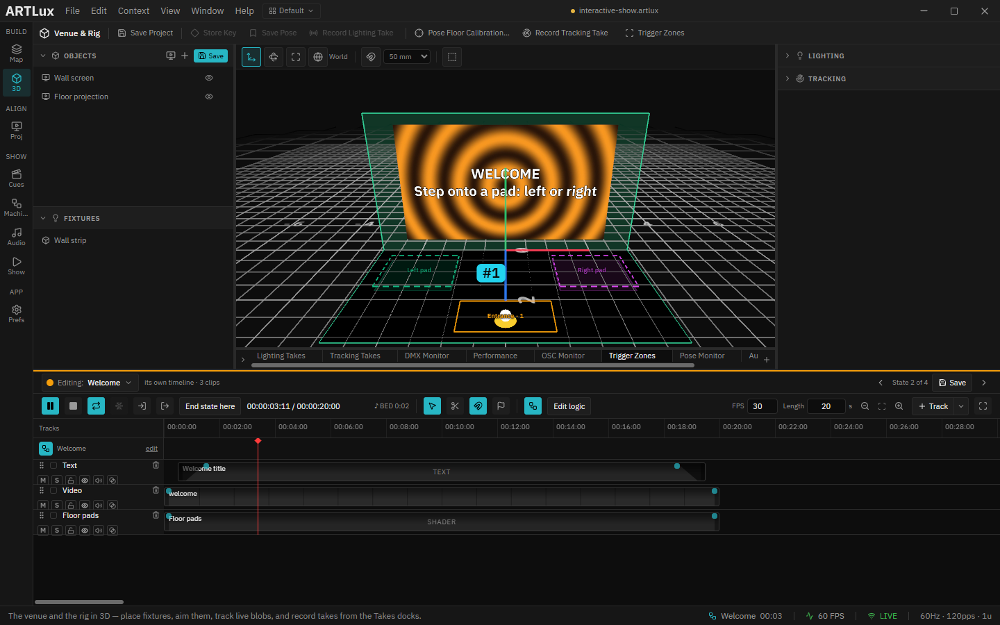

# Interactive show — a room that reacts to visitors

A ready-made installation: a lobby with a video wall and a tracked floor. When nobody is there, an
attract loop plays. Someone walks in and the wall says hello; they step onto the left or the right pad
and one of two stories plays; the room empties and the show goes back to waiting. Four looks, three floor
zones, Full HD video and a title on every look. Open it, send it a pretend visitor, and watch it run.

| | |
|---|---|
| **Project** | [`interactive-show.artlux`](interactive-show.artlux) |
| **Course** | [`tuto/`](tuto/README.md), five short chapters |
| **Needs** | ArtLux. [Node.js](https://nodejs.org) only for the pretend visitor (chapter 1 shows a way without it) |
| **Media** | four 20-second 1920×1080 MP4 loops in `assets/video/`, about 3–4 MB each |

## What is in it

- **Four states**, each with its own look: **Attract** (nobody here), **Welcome** (someone came in),
  **Story A** and **Story B** (the two choices).
- **Three zones** on the floor: **Entrance**, **Left pad**, **Right pad**. Each zone wears the colour of
  the state it leads to.
- **On every state's timeline:** the video, a title in text, and the pads painted on the floor.
- **A 3D view of the room** at its real size, with the wall screen and the floor projection, so you can
  explain every rule of the show by pointing at the floor.

Nothing here talks to real hardware: Art-Net goes to `127.0.0.1` (this computer) and both projector
outputs start switched off.

## Files

| File | What it is |
|---|---|
| `interactive-show.artlux` | the project |
| `assets/video/*.mp4` | the four clips, one per state |
| `visitor.cjs` | the pretend visitor: walks the whole show over the network, like a real tracker would |
| `make-media.cjs` | rebuilds the four clips with ffmpeg (they are generated, not filmed) |
| `make-project.cjs` | rebuilds the project file; edit the zones or the rules there and re-run it |

Start with the [course](tuto/README.md).
