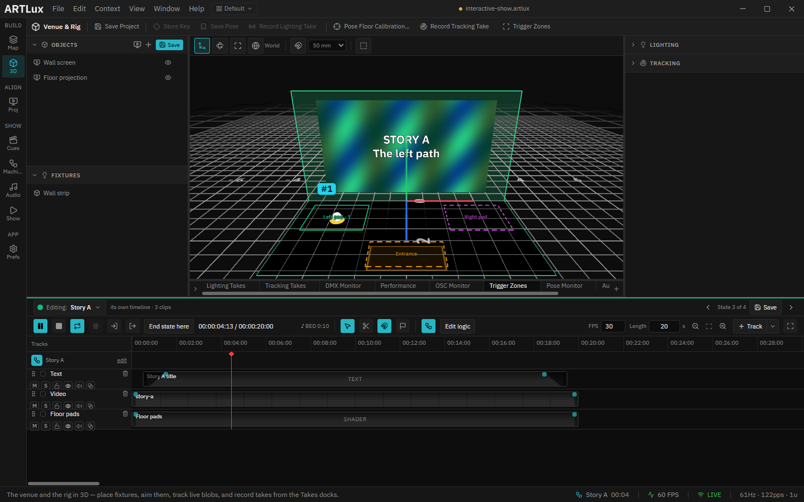

# 01 · Open it and send a visitor

> Project: [`../interactive-show.artlux`](../interactive-show.artlux)
> You'll learn: how the show reacts to people, how to switch on the tracking input, and how to test the
> whole show with a pretend visitor.

This show has no Play button that matters. Nobody presses anything: **the people in the room drive it.**
This chapter proves that in about two minutes. You send a pretend visitor through the room and watch the
show follow them, state by state, with your hands off the mouse.

## 1. Open the project

1. **File ▸ Open…** (`Ctrl+O`) and pick `interactive-show.artlux`.
2. In the **left rail** (the column of icons on the far left), click **3D** (the cube icon, *Build*
   group).

You are looking at the room, at its real size. At the back stands the **wall**, playing a blue loop with
the title **ARTLUX — Walk in to begin**. On the floor are three outlined rectangles: the **Entrance**
(orange, nearest to you) and two **pads** (green on the left, magenta on the right). These are the
**zones**, the parts of the floor the show watches.

At the bottom right of the window, the status bar reads **Attract** and a running time. **Attract** is
the current **state**: the look the show runs while nobody is here.

## 2. Let ArtLux hear the tracker

In a real venue a LiDAR **tracker** sends ArtLux the position of every person, over the network, on
port **10000**. The pretend visitor sends exactly the same messages, so ArtLux has to be listening.

1. Click **Prefs** at the bottom of the left rail and open **OSC / Tracking**.
2. Turn **OSC receive** on.
3. Set **Listen port** to `10000`.
4. Set **Bind address** to **All** (or `127.0.0.1`, to listen to this computer only).

You only do this once per computer. It is a setting of the machine, not of the project.

## 3. Send a visitor

The pretend visitor is a small script, `visitor.cjs`. It needs [Node.js](https://nodejs.org). Open a
terminal and run it from where the file is:

```bash
# from the folder this project is in (a source checkout, or the copy the Launcher made)
node visitor.cjs

# from an installed ArtLux, the script ships with the app:
#   Windows  node "C:\Program Files\ArtLux\resources\examples\interactive-show\visitor.cjs"
#   macOS    node /Applications/ArtLux.app/Contents/Resources/examples/interactive-show/visitor.cjs
```

> **The Launcher's copy leaves the scripts out.** The examples the Launcher copies into
> `Documents\ArtLux Projects` contain the project and its media but no `.cjs` files. Run `visitor.cjs`
> from the installed path above instead; it talks to whichever ArtLux is open, so it does not matter
> where it lives.

The script prints each step as it happens. Keep your eyes on the 3D view:

1. **4 s:** a white marker appears at the front of the room and walks into the **Entrance**. The
   Entrance outline turns solid, and the wall switches to an orange loop titled **WELCOME — Step onto a
   pad: left or right**. The status bar reads **Welcome**.

   

2. **12 s:** the visitor crosses to the **Left pad** and stands there. After a second and a half, the
   wall turns green: **STORY A — The left path**.

   

3. **20 s:** the visitor walks out. The room is empty, and **six seconds later** the wall goes back to
   blue: **Attract**.
4. **34 s:** a second walk, this time to the **Right pad**: **Welcome**, then **STORY B** in magenta,
   then back to **Attract** once they leave.

That is the whole show: four states, and the room choosing between them.

## 4. No Node.js? Fire the states by hand

You can still see every look without a visitor:

1. In the left rail, click **Machine** (*Show* group). This is the **Show Machine**: the show drawn as
   circles (states) and arrows (transitions).
2. **Double-click** a circle, for example **STORY B**. The show jumps straight to that state.
3. Go back to **3D**: the wall shows Story B.

Firing by hand skips the rules, which makes it the right tool for checking a look and the wrong tool for
checking the show. Chapter 5 comes back to that.

## Try it yourself

Run the visitor again, and while it stands on the **Left pad**, double-click **ATTRACT** in the Show
Machine. The show goes back to Attract, and it **stays** there even though someone is standing on the
pad. Chapter 3 explains why: a rule only applies to the state its arrow starts from, and no arrow leaves
Attract towards Story A.

Then watch the visitor leave. Their way out crosses the **Entrance**, so the show plays **Welcome** for
them on the way out. The Entrance is also the exit, and the rules cannot tell the difference. That is a
real design question for a room like this one, not a bug.

➡ Next: [02 · What each state plays](02-what-each-state-plays.md)
