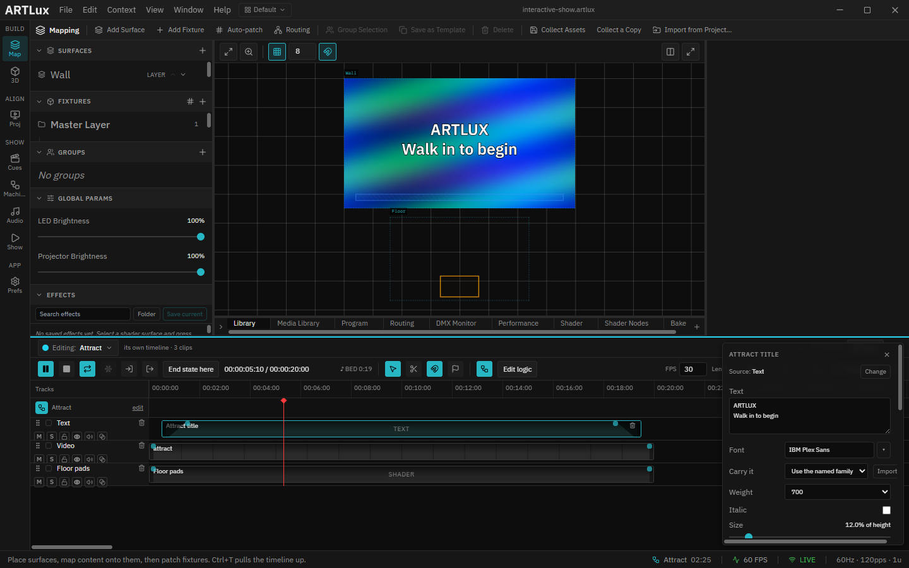

# 02 · What each state plays

> Project: [`../interactive-show.artlux`](../interactive-show.artlux)
> You'll learn: that every state owns its own timeline, how a Full HD video and a title share the wall,
> and why the floor shows different pads in each state.

Each of the four states looks different, and none of them shares anything with the others: **a state
owns its own timeline.** Changing the Welcome title cannot touch Story A. This chapter takes one state
apart, track by track.

## 1. Open a state's timeline

1. In the left rail, click **Map** (the layers icon, *Build* group). The middle of the window shows the
   **surfaces**, the pictures ArtLux composes: the **Wall** at the top, the **Floor** below it.
2. Press `Ctrl+T` to open the **timeline** along the bottom of the window.
3. At the top left of the timeline, the pill reads **Editing: Attract**. The timeline you see belongs to
   the **Attract** state, and nothing else. The arrows at the top right (**◂ State 1 of 4 ▸**) step
   through the other states' timelines.

> **Stepping through states is editing, not firing.** Click **▸** and the window shows Welcome's look so
> you can work on it, but the status bar at the bottom right still says **Attract**: the show itself has
> not moved. Only a rule, or a double-click in the Show Machine, changes the state the show is in.

Every state's timeline has the same three **tracks**, one per row:

| Track | Plays | Shown on |
|---|---|---|
| **Text** | the state's title, as typed text | the Wall, in front of the video |
| **Video** | the state's 20-second loop, a 1920×1080 MP4 | the Wall, behind the title |
| **Floor pads** | the pads painted on the floor | the Floor |

The order of the rows is the order of depth: **the top track is in front.** That is why the title sits
over the video and not under it.

## 2. The video

The four clips are in `assets/video/`, one per state, all 1920×1080 H.264 MP4s that loop seamlessly
every 20 seconds. Each one is the colour of its state: blue for Attract, orange for Welcome, green for
Story A, magenta for Story B. A visitor who glances at the wall can tell where the show is without
reading a word.

The video clip fills its track from 0 to 20 s, and the timeline is set to **loop**, so a state can last
as long as the room wants it to.

> **Use MP4 (H.264) for video here.** ArtLux decodes it on the graphics card, so a Full HD loop costs
> almost nothing. The clips in this project were generated rather than filmed, which keeps them small
> and free to share. `make-media.cjs` rebuilds them with ffmpeg if you want different colours.

## 3. The title

Click the **Attract title** clip on the **Text** track. Its settings open on the right.

1. In the **Text** box, the title is two lines: `ARTLUX` and `Walk in to begin`. Edit them and the wall
   changes as you type.
2. **Size** is a percentage of the surface's height (12% here), so the title keeps its proportions if the
   wall is resized.
3. The clip starts half a second in and has a **1-second fade** at each end: the small handles in its
   top corners. Drag one to make the fade longer.

> **Why a separate title per state?** The words of a text clip cannot be animated: there is no way to say
> "these words until 5 s, then those". A different title means a different clip, and the simplest home for
> it is the timeline of the state it belongs to.

## 4. The floor pads

Look at the **Floor** surface in Map. In Attract, only the **Entrance** is painted, as an orange
rectangle near the bottom. Step to the next state (**▸**) and the Floor shows the two **pads** instead.

The pads are a picture projected onto the real floor, drawn exactly where the zones are, so visitors can
see where to stand. Each state lights only the pads that matter to it:

| State | Lit on the floor | Telling the visitor… |
|---|---|---|
| Attract | Entrance | come in |
| Welcome | Left pad, Right pad | choose a side |
| Story A, Story B | Entrance | the way out |

The **Floor** surface also draws a marker for every tracked person on top of the pads, which is how you
check on site that the tracker and the projection agree.

## Try it yourself

1. Step to **Story A** (**▸** twice) and change its title to anything you like.
2. Fire **Story A** from the Show Machine (double-click it). Your title is there.
3. Fire **Story B**. Its title has not changed, because Story B has its own timeline.
4. Back in Story A, click the **M** (mute) button on the **Text** track. The wall shows the video alone.
   Unmute it before you move on.

➡ Next: [03 · The rules, and the branch](03-the-rules-and-the-branch.md)
