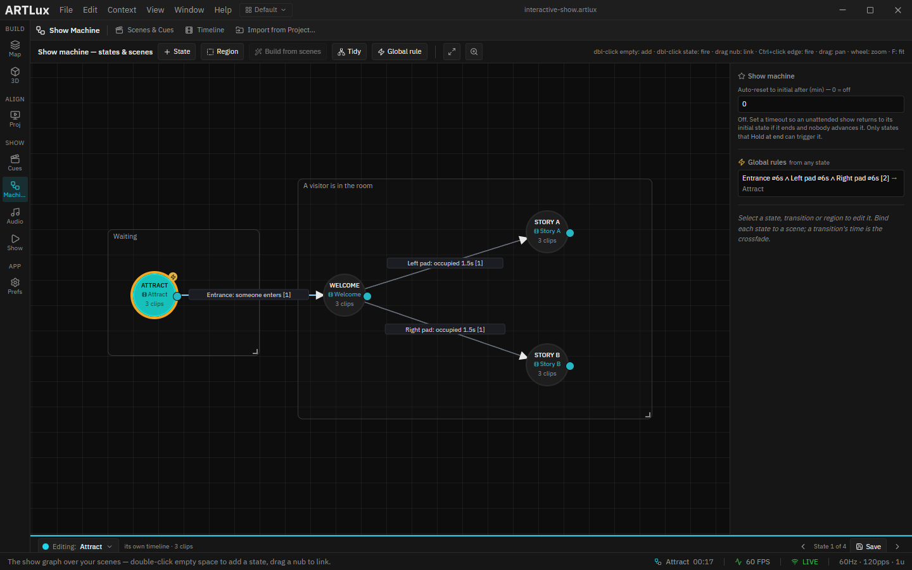
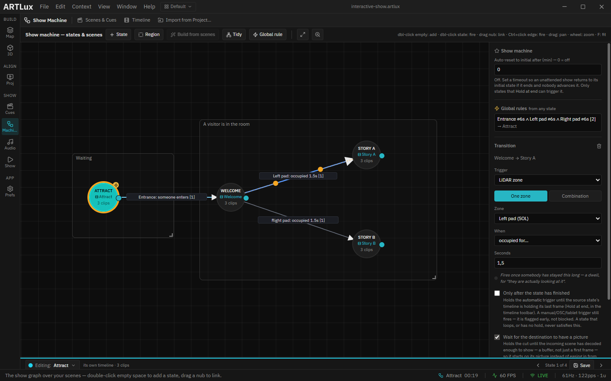
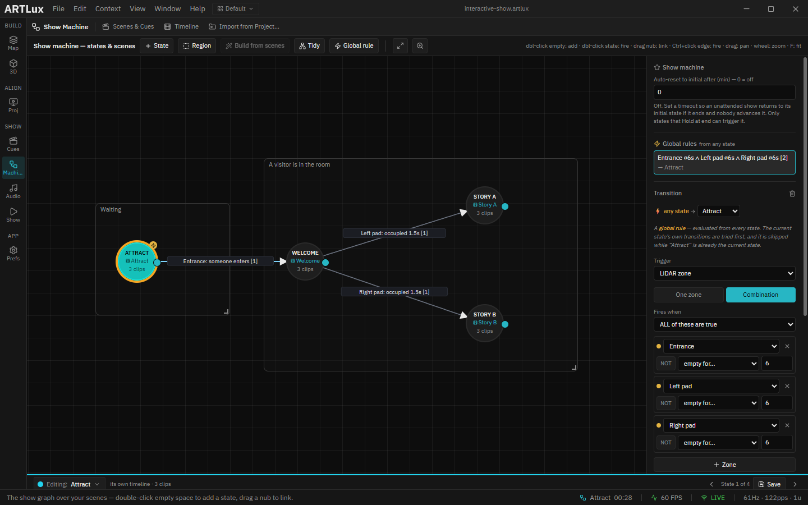
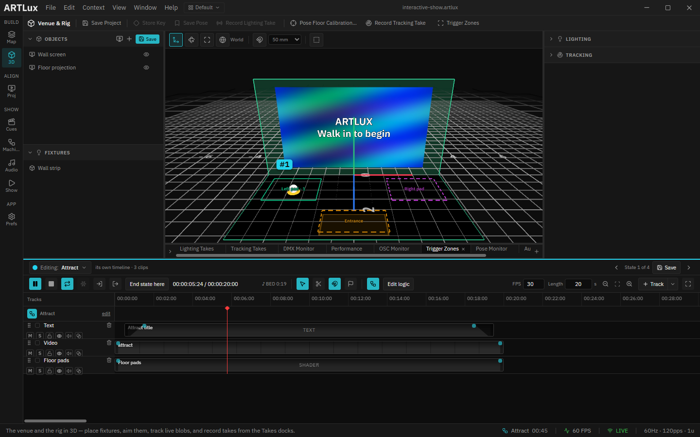

# 03 · The rules, and the branch

> Project: [`../interactive-show.artlux`](../interactive-show.artlux)
> You'll learn: how a rule reads the room, why the pads wait 1.5 seconds, how one state branches two ways,
> and why the way back is a single rule instead of three arrows.

Every change of state in this show is a question about the floor: *has someone come in? has someone
stayed on the left pad? is the room empty?* **A rule is a question about a zone, and an arrow fires when
its question becomes true.** There are four rules in this show, and this chapter reads each one.

## 1. Open the Show Machine

In the left rail, click **Machine** (*Show* group).

- Each **circle** is a state. The one ringed in its colour is the state the show is in right now.
- Each **arrow** is a transition, labelled with its rule.
- The two boxes, **Waiting** and **A visitor is in the room**, are **regions**: labels for you. They
  change nothing about how the show runs.

Click an arrow's label to see its rule in the panel on the right.

## 2. "Someone enters" — Attract to Welcome

Click **Entrance: someone enters**. The rule is **LiDAR zone**, **One zone**, **Entrance**,
**someone enters**.

It fires the moment the Entrance goes from empty to occupied. One detail matters: if someone is
**already** standing in the Entrance when the show arrives in Attract (because you fired Attract by
hand, say), the rule waits for them to leave and for someone to come in again. **A rule fires on a
change in the room, not on how the room happens to be**, otherwise a visitor standing still in the right
place would fire it again and again.

## 3. "Occupied for 1.5 s" — the branch

Click **Left pad: occupied 1.5s**.

This rule does not fire when someone steps on the pad, but when they have **stayed** there for 1.5
seconds. Without that wait, a visitor walking across the left pad on their way to the right one would set
off the wrong story.

Now look at **Welcome**: two arrows leave it, one to Story A and one to Story B. That is the **branch**.
While the show is in Welcome, both rules are listened to at once, and **whichever becomes true first
fires.** Nothing else is needed to make a choice. Two arrows out of one state is how a show offers one.

Underneath the rule you will also see **Wait for the destination to have a picture**, ticked. It holds
the cut for the few frames the next video needs to start, so the wall never flashes black between two
stories.

## 4. The way back: one rule for every state

In the panel on the right, under **⚡ Global rules** (*from any state*), click the line ending
**→ Attract**.

This rule has no arrow because it does not start from one state: a **global rule** is listened to in
**every** state. It is a **Combination**: **ALL** of three questions must be true together:

- the **Entrance** has been empty for 6 s,
- the **Left pad** has been empty for 6 s,
- the **Right pad** has been empty for 6 s.

In other words: nobody has been anywhere for six seconds. The dot beside each line lights while that
part is true, so you can watch the room empty one zone at a time.

Why one global rule rather than an arrow from each state? Three arrows would work today. Then someone adds
a fifth state next month, forgets its arrow back, and the show sticks there the first time a visitor leaves.
A global rule cannot be forgotten that way. It is skipped while the show is already in Attract, so it never
restarts the attract loop.

> **The 6 s is a little longer in practice.** A zone only counts as empty once nobody has been seen in it
> for **0.8 s** (the *exit dwell*, set for the whole room in chapter 4), so the show returns about
> 6.8 seconds after the last visitor leaves. The visitor script's timings already allow for it.

## 5. Rules belong to the state they leave

Here a visitor is standing on the Left pad, the pad's outline is solid, and the show is still in
**Attract**. Nothing is wrong. The Left pad rule starts from **Welcome**, so it is only listened to in
Welcome. A rule is a question **one state** asks; the other states do not hear the answer.

## Try it yourself

1. Click **Left pad: occupied 1.5s** and set **Seconds** to `0`. Run the visitor (chapter 1) and watch it
   cross towards the Left pad: Story A now fires the instant it touches the pad's edge.
2. Put it back to `1.5`.
3. In the global rule, remove the **Right pad** line (the **×** at its end). Run the visitor: on its
   second walk it stands on the Right pad, and Story B lasts only a few seconds before the show goes back
   to Attract, with the visitor still standing there. The rule no longer looks at the Right pad, so a
   person on it counts as nobody.
4. Put the line back: **+ Zone**, pick **Right pad**, **empty for…**, `6`. (Or reopen the project
   without saving.)

➡ Next: [04 · The room in 3D](04-the-room-in-3d.md)
