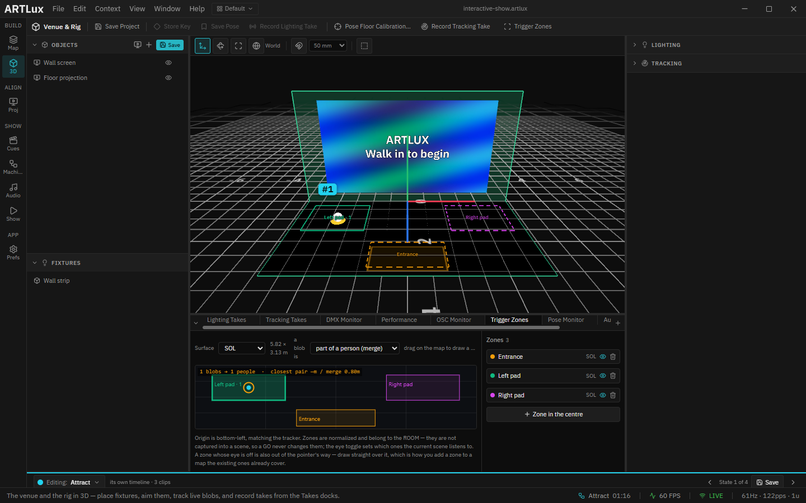

# 04 · The room in 3D

> Project: [`../interactive-show.artlux`](../interactive-show.artlux)
> You'll learn: what the 3D view shows and at what scale, how the two screens get their pictures, where
> the zones are drawn and tuned, and why the painted pads must follow the zones.

The 3D view is where this show makes sense to someone who has never seen the venue: the wall, the floor,
the zones, a visitor's marker and the picture they trigger, all in one place and to scale. **Everything
you see there is the same data the show runs on**, not a drawing of it, which is what makes it the right
place to check a rule.

## 1. The room, to scale

In the left rail, click **3D**.

- The **green outlines** are the tracked area: the floor (**SOL**) and the wall (**MUR**), 5.825 m wide,
  3.125 m deep and 3.125 m high. A real tracker reports its own size when it starts sending, and the view
  follows it.
- The grid is in metres. The view opens framed on the whole room. Drag to orbit, scroll to zoom,
  right-drag to pan.
- Each **zone** is outlined in its colour. A **dashed** outline is empty; a **solid** one has someone in it,
  and its label shows the headcount (`Left pad · 1`).
- Each tracked person is a white marker with a number (**#1**).

## 2. The two screens

At the top left, the **Objects** list shows **Wall screen** and **Floor projection**. They are flat
screens placed in the room, and each one shows a **surface's** live picture: whatever that surface is
playing right now.

Click **Floor projection**. On the right, **Content** says **Floor**: this screen shows the Floor surface
(the pads and the visitor markers from chapter 2). Its **Scale**, **Position** and **Rotation** lay it
flat on the floor and make it exactly the size of the tracked area, so a pad drawn on the Floor surface
lands right on top of its zone.

**Wall screen** shows the **Wall** surface: the video and the title. When a rule fires, it is the first
thing in the room to change.

> **Screens are a preview.** They show you what the projectors will show; they do not send anything to a
> projector. Real outputs are set up in the **Proj** context (chapter 5).

## 3. Drawing and tuning the zones

Click **Trigger Zones** on the action bar at the top of the window. The panel opens below the 3D view.

- The map is the floor seen from above, wall at the top. **Drag on empty space** to draw a new zone,
  **drag a zone** to move it, **drag a corner** to resize it.
- The line above the map counts what the tracker sees: **1 blobs → 1 people**. A real LiDAR often sees
  one person as two blobs; **part of a person (merge)** groups them back into one person before any zone
  counts them.
- The list on the right has one line per zone. The **eye** says whether the state you are editing listens
  to that zone. All of them are on in this project.

Two timings belong to the whole room rather than to one zone. Open **Tracking** in the column on the
right of the 3D view:

| Setting | Here | What it does |
|---|---|---|
| **Zone enter dwell** | 0.25 s | how long someone must be seen before a zone counts as occupied |
| **Zone exit dwell** | 0.8 s | how long they must be gone before it counts as empty again |

Raise the enter dwell if passers-by set things off; raise the exit dwell if a visitor standing still
keeps "disappearing" for a moment. You tune both on site, once, for the room.

> **Moving a zone does not move its painted pad.** The pads on the floor (chapter 2) were drawn from the
> zones' positions when the project was made. Drag a zone here and the show reacts to the new rectangle
> while the floor still shows the old one, so visitors stand where nothing happens. To move both, change
> the zone's numbers in `make-project.cjs` and re-run it (it rewrites the whole project), or repaint the
> pads yourself.

## Try it yourself

1. In **Trigger Zones**, drag the **Left pad** zone down into the front-left corner of the floor, beside
   the Entrance. (Away from the visitor's path, so they never cross it by accident.)
2. Run the visitor (chapter 1). It walks to where the pad is **painted**, stands there, and Story A
   never comes: the zone it should be standing in has moved.
3. Reopen the project without saving to put things back.

➡ Next: [05 · Test it, then run it](05-test-then-run.md)
