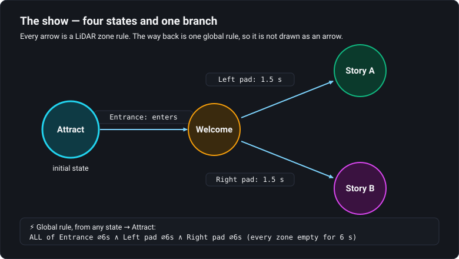
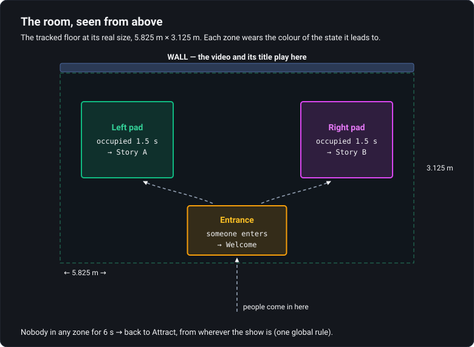

# Tutorial — build a show the room drives

A five-chapter course on one project, [`interactive-show.artlux`](../interactive-show.artlux): a lobby
installation where the people in the room decide what plays. By the end you will know how each piece is
made, why it is made that way, and how to test the whole thing at your desk with nobody in the room.

You need ArtLux. Node.js helps (it runs the pretend visitor) but chapter 1 also shows a way without it.

## The words this course uses

| Word | What it means here |
|---|---|
| **State** | one moment of the show: *Attract*, *Welcome*, *Story A*, *Story B*. Each state shows its own look. |
| **Transition** | an arrow from one state to another, with a **rule** that says when it fires. |
| **Zone** | a rectangle drawn on the tracked floor. Rules ask questions about zones: *has someone stepped in?* |
| **Tracker** | the LiDAR sensor in a real venue. It reports where each person stands, many times a second. |
| **Surface** | a picture ArtLux composes: here the **Wall** (video + title) and the **Floor** (the pads). |
| **Timeline** | the strip of tracks at the bottom of the window. Every state has its own. |

## The show in one picture

## The course

| # | Chapter | You'll learn |
|---|---------|--------------|
| 1 | [Open it and send a visitor](01-open-and-walk.md) | turn on the tracking input, run the pretend visitor, watch every state fire |
| 2 | [What each state plays](02-what-each-state-plays.md) | a state's own timeline: a Full HD video, a title in text, the floor pads |
| 3 | [The rules, and the branch](03-the-rules-and-the-branch.md) | *someone enters*, *occupied for*, a branch, and one global rule built from three zones |
| 4 | [The room in 3D](04-the-room-in-3d.md) | the 3D view at real size, the two screens, the zone editor, the dwell settings |
| 5 | [Test it, then run it](05-test-then-run.md) | testing with nobody there, broadcast mode, and what changes in a real venue |

Work through them in order. Each chapter ends with a **Try it yourself** that has you break something
on purpose.

> **Keep the original.** Before you change anything, use **File ▸ Save As…** and save a copy under a new
> name. The course always refers to the project as shipped.

## Where to go deeper

- [The state machine](../../../docs/user-guide/14-show-state-machine.md) and
  [tracking](../../../docs/user-guide/13-tracking.md) chapters of the user guide.
- [The state-machine course](../../state-machine/tuto/README.md) (all seven kinds of trigger) and the
  [LiDAR course](../../lidar-tracking/tuto/README.md) (calibrating a real floor, recording takes).
- [Text on a surface](../../../docs/TEXT.md) for everything a title can do.
