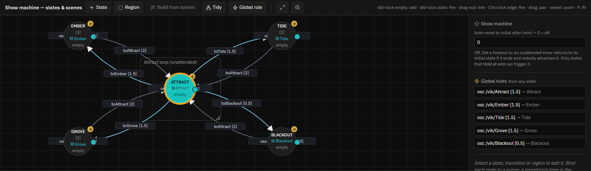

# Tutorial — Voice control with VIK

A visitor talks to the installation, and the installation answers by changing what it shows. Two programs share
the work:

- **VIK** (the Voice Interaction Kit) hears the visitor, decides what they asked for, answers out loud, and sends an
  **OSC message**. What it sends, and for which sentences, is set in VIK, in a **pattern**: *When* the person
  mentions a scene → *Then* **Send OSC**.
- **ArtLux** receives the message on its OSC port and changes the look, or moves its show machine.

*Each performance has two links with Attract: the way in, by hand, and the way back after 10 s. They bow to opposite
sides, so both arrows stay readable. The five global rules on the right are the voice's: `/vik/<state>`, from any
sender.*

## Before you start

- **ArtLux**, with this folder (**Help ▸ Docs & Tutorials** shows these pages inside the app).
- **VIK 3.3 or later**: the installer is on [its releases page](https://github.com/b2renger/voice-interaction-kit/releases/latest).
  The first launch downloads its models once (about 1.8 GB). Then it runs offline.
- A microphone and speakers. You can also **type** your sentences in VIK, to try everything in silence.

## The chapters

| | Chapter | You end up with |
|---|---|---|
| 1 | [Scenes by voice](01-scenes-by-voice.md) | "Show me the forest": VIK sends `/artlux/scene/recall Grove`, and the look changes. Works with any project. |
| 2 | [The show machine by voice](02-the-show-machine-by-voice.md) | The OSC message edited in VIK (`/vik/{scene}`), and ArtLux's global rules taking the show into each state, which returns to Attract by itself. Then your own messages and triggers. |
